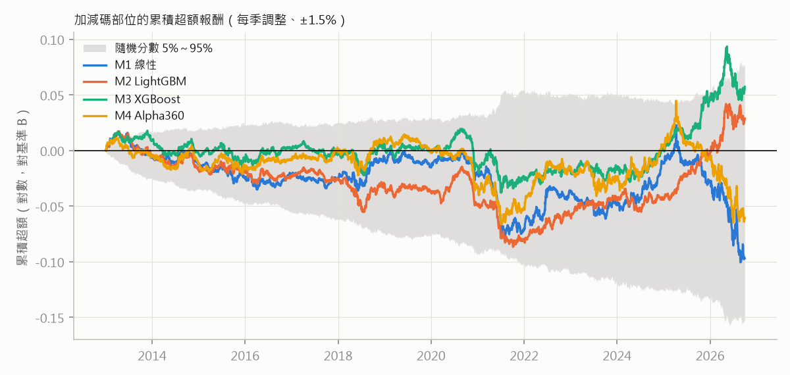

# 台積電中立的增強型指數（事後探索）

由 `qbot/tw_research/explore_enhanced.py` 產生。**描述性回測，不參與判定**：2013-01 至 2026-09 全部是已看過的期間，
模型預測是 walk-forward 樣本外（同 `etf_sim.py`），但這個設計是看過 ETF 模擬與差距拆解之後才提出的。
設計在執行前固定（見程式開頭），沒有依結果調整。

**設計**：每季取市值代理前 50 檔，台積電 = min(市值權重, 25%)，其餘依市值加權 → 基準 B。
增強組合的台積電權重和 B 相同，其餘 49 檔依模型分數排名加減碼（最高 +1.5%、最低 −1.5%，權重不為負）。
隔一個交易日收盤成交、期間不再平衡，扣散戶成本，不扣經理費。

**限制**：市值 = 未還原收盤價 × 2026-10 的發行股數（沒有歷史股數與自由流通調整）；股票池只含現存公司；
台積電條款是 2026-04 才有的規定，之前的年份是假設性的。B 與增強組合裡台積電以外單一個股的目標權重最高 10.3%
（法規上限 10%；這個設計沒有另設 10% 上限，少數調整日略為超過）。

## 各組合和 0050

| 組合 | 全期 2013–2026/09 年化 | 全期 2013–2026/09 Sharpe | 2013–2020 年化 | 2013–2020 Sharpe | 2021–2026/09 年化 | 2021–2026/09 Sharpe | 最大回撤 | 年換手（買進） | 贏 0050 年數 |
|---|---|---|---|---|---|---|---|---|---|
| 0050（含息） | 20.9% | 1.10 | 14.5% | 0.96 | 30.5% | 1.28 | -34.0% | — | — |
| 基準 B（台積電 ≤25%） | 18.9% | 1.03 | 12.4% | 0.86 | 28.8% | 1.24 | -33.2% | 27% | 6/14 |
| CW50（台積電不設上限） | 19.9% | 1.04 | 13.0% | 0.88 | 30.3% | 1.23 | -35.6% | 22% | 7/14 |
| CW50 不含台積電 | 15.1% | 0.88 | 7.6% | 0.60 | 26.4% | 1.18 | -30.5% | 30% | 3/14 |
| 增強｜M1 線性 | 18.3% | 1.04 | 12.1% | 0.85 | 27.4% | 1.26 | -31.1% | 91% | 2/14 |
| 增強｜M2 LightGBM | 19.2% | 1.04 | 11.7% | 0.81 | 30.6% | 1.30 | -31.9% | 98% | 6/14 |
| 增強｜M3 XGBoost | 19.5% | 1.06 | 12.2% | 0.84 | 30.5% | 1.30 | -32.7% | 97% | 7/14 |
| 增強｜M4 Alpha360 | 18.6% | 1.06 | 11.9% | 0.84 | 28.6% | 1.31 | -30.3% | 89% | 5/14 |

## 加減碼本身：增強組合減基準 B

隨機分數百分位：同樣的加減碼規則改用隨機分數（300 次），資訊比率贏過幾成的隨機版本。
隨機版本全期的資訊比率 5%／50%／95% 分位：-0.71／-0.19／0.37
（超額年化 -1.3%／-0.4%／+0.7%）。

| 模型 | 期間 | 超額年化 | 追蹤誤差 | 資訊比率 | NW t | 贏 B 年數 | 隨機分數百分位 | 超額的 beta | 扣 beta 後 |
|---|---|---|---|---|---|---|---|---|---|
| M1 線性 | 全期 2013–2026/09 | -0.7% | 2.2% | -0.33 | -1.17 | 4/14 | 34% | -0.050 | +0.2% |
| M1 線性 | 2013–2020 | -0.2% | 1.5% | -0.16 | -0.45 | 2/8 | 58% | -0.018 | -0.0% |
| M1 線性 | 2021–2026/09 | -1.4% | 2.9% | -0.47 | -1.10 | 2/6 | 25% | -0.070 | +0.6% |
| M2 LightGBM | 全期 2013–2026/09 | +0.3% | 1.8% | 0.13 | 0.46 | 5/14 | 85% | +0.000 | +0.2% |
| M2 LightGBM | 2013–2020 | -0.7% | 1.5% | -0.43 | -1.15 | 0/8 | 31% | -0.000 | -0.6% |
| M2 LightGBM | 2021–2026/09 | +1.8% | 2.2% | 0.65 | 1.55 | 5/6 | 94% | +0.001 | +1.4% |
| M3 XGBoost | 全期 2013–2026/09 | +0.5% | 2.0% | 0.23 | 0.85 | 8/14 | 89% | -0.008 | +0.6% |
| M3 XGBoost | 2013–2020 | -0.2% | 1.5% | -0.12 | -0.33 | 3/8 | 61% | -0.002 | -0.2% |
| M3 XGBoost | 2021–2026/09 | +1.8% | 2.5% | 0.54 | 1.30 | 5/6 | 89% | -0.011 | +1.6% |
| M4 Alpha360 | 全期 2013–2026/09 | -0.3% | 2.2% | -0.20 | -0.71 | 5/14 | 50% | -0.054 | +0.6% |
| M4 Alpha360 | 2013–2020 | -0.4% | 1.5% | -0.27 | -0.75 | 3/8 | 47% | -0.024 | -0.1% |
| M4 Alpha360 | 2021–2026/09 | -0.2% | 2.9% | -0.15 | -0.37 | 2/6 | 53% | -0.073 | +1.6% |

## 敏感度（只報告）

| 模型 | 設定 | 超額年化 | 追蹤誤差 | 資訊比率 | NW t | 贏 B 年數 |
|---|---|---|---|---|---|---|
| M1 線性 | 加減碼加倍（±3%） | -0.6% | 3.1% | -0.23 | -0.86 | 5/14 |
| M1 線性 | 每半年調整 | -0.7% | 2.1% | -0.34 | -1.23 | 6/14 |
| M2 LightGBM | 加減碼加倍（±3%） | +0.5% | 2.8% | 0.17 | 0.62 | 5/14 |
| M2 LightGBM | 每半年調整 | +0.2% | 1.7% | 0.09 | 0.30 | 7/14 |
| M3 XGBoost | 加減碼加倍（±3%） | +1.1% | 3.0% | 0.32 | 1.19 | 7/14 |
| M3 XGBoost | 每半年調整 | +0.5% | 1.9% | 0.21 | 0.78 | 7/14 |
| M4 Alpha360 | 加減碼加倍（±3%） | +0.2% | 3.2% | -0.03 | -0.10 | 6/14 |
| M4 Alpha360 | 每半年調整 | +0.2% | 2.2% | 0.01 | 0.04 | 7/14 |

## 欄位說明

- **年換手（買進）**：每年買進金額占淨值的比例；賣出大致相同。
- **超額年化**：年化報酬差（增強 − B）。**追蹤誤差**：日超額報酬的年化標準差。**資訊比率**：年化超額平均 ÷ 追蹤誤差。
- **超額的 beta**：日超額報酬對 B 的迴歸係數；負值代表加減碼偏向低波動股，在多頭裡會少賺。
  **扣 beta 後**：日超額報酬減掉 beta × B 之後的年化平均（算術平均，和上面的年化報酬差口徑不同）。
- **NW t**：日超額報酬的 Newey-West t（落後 5 日）。2026 年只到 9 月。
