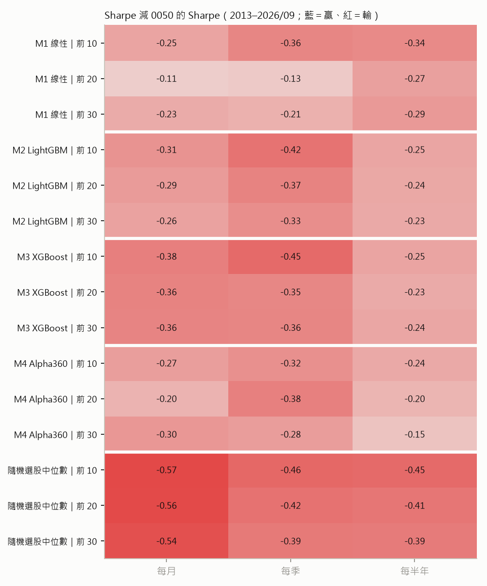
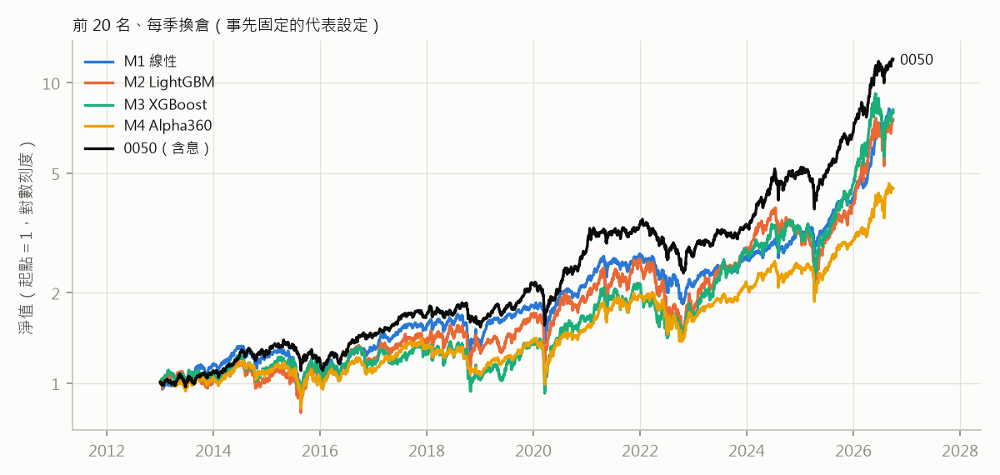

# 四個多因子模型模擬成 ETF：和 0050 比較

由 `qbot/tw_research/etf_sim.py` 產生。**描述性回測，不是預先承諾的檢驗**：36 組設定裡表現最好的那組有選擇偏差，
要和下方「隨機選股 ETF」的分布一起看。

**設定**：模型每年用過去的資料重新訓練（walk-forward），2013-01 至 2026-09 全部是樣本外預測。
每個換倉期最後一個交易日依分數取前 N 名，隔日收盤等權買進（當天漲停買不到就換下一名），持有到下次換倉；
扣散戶交易成本（手續費 0.1425%×2.8 折、賣出證交稅 0.3%），**不扣 ETF 經理費**（0050 的報酬已扣它自己的費用）。
股票池是每季流動性前 200 名，但清單只含現存公司（存活者偏差）；隨機選股 ETF 有同樣的偏差，可以用來對照。

## 摘要

- 0050（含息）：年化報酬 20.6%、Sharpe 1.09、最大回撤 -34.0%。
- 36 組中全期 Sharpe 高於 0050 的有 **0 組**（2013–2020：0 組；2021–2026/09：4 組）。
- 全期 Sharpe 最高的是 M1 線性、前 20 名、每月換倉：Sharpe 0.97
  （0050 1.09），年化報酬 17.9%（0050 20.6%），
  在同設定的隨機選股 ETF 中贏過 100%。

## 全期 2013–2026/09

0050（含息）：年化報酬 20.6%、Sharpe 1.09、最大回撤 -34.0%。

| 模型 | 檔數 | 換倉 | 年化報酬 | Sharpe | 最大回撤 | 報酬差 vs 0050 | Sharpe 差 vs 0050 | beta | 贏 0050 年數 | 隨機 ETF 百分位 |
|---|---|---|---|---|---|---|---|---|---|---|
| M1 線性 | 10 | 每月 | 15.2% | 0.83 | -37.1% | -5.4% | -0.25 | 0.72 | 5/14 | 99% |
| M1 線性 | 10 | 每季 | 12.3% | 0.73 | -35.2% | -8.2% | -0.36 | 0.68 | 3/14 | 77% |
| M1 線性 | 10 | 每半年 | 12.6% | 0.75 | -34.9% | -7.9% | -0.34 | 0.69 | 4/14 | 80% |
| M1 線性 | 20 | 每月 | 17.9% | 0.97 | -33.5% | -2.7% | -0.11 | 0.76 | 4/14 | 100% |
| M1 線性 | 20 | 每季 | 16.9% | 0.96 | -34.0% | -3.7% | -0.13 | 0.73 | 4/14 | 99% |
| M1 線性 | 20 | 每半年 | 13.9% | 0.82 | -37.2% | -6.7% | -0.27 | 0.73 | 6/14 | 93% |
| M1 線性 | 30 | 每月 | 15.3% | 0.86 | -33.8% | -5.2% | -0.23 | 0.78 | 6/14 | 100% |
| M1 線性 | 30 | 每季 | 15.1% | 0.88 | -33.1% | -5.5% | -0.21 | 0.74 | 6/14 | 98% |
| M1 線性 | 30 | 每半年 | 13.2% | 0.80 | -32.5% | -7.3% | -0.29 | 0.73 | 4/14 | 89% |
| M2 LightGBM | 10 | 每月 | 21.0% | 0.77 | -52.2% | +0.5% | -0.31 | 1.03 | 9/14 | 97% |
| M2 LightGBM | 10 | 每季 | 16.4% | 0.67 | -47.6% | -4.2% | -0.42 | 1.00 | 4/14 | 59% |
| M2 LightGBM | 10 | 每半年 | 21.7% | 0.84 | -46.3% | +1.2% | -0.25 | 0.96 | 7/14 | 92% |
| M2 LightGBM | 20 | 每月 | 20.2% | 0.80 | -53.6% | -0.4% | -0.29 | 1.01 | 10/14 | 99% |
| M2 LightGBM | 20 | 每季 | 16.5% | 0.72 | -49.0% | -4.1% | -0.37 | 0.96 | 5/14 | 70% |
| M2 LightGBM | 20 | 每半年 | 19.2% | 0.85 | -47.2% | -1.3% | -0.24 | 0.91 | 8/14 | 95% |
| M2 LightGBM | 30 | 每月 | 20.0% | 0.83 | -49.9% | -0.6% | -0.26 | 0.99 | 10/14 | 100% |
| M2 LightGBM | 30 | 每季 | 16.7% | 0.76 | -47.3% | -3.8% | -0.33 | 0.94 | 5/14 | 79% |
| M2 LightGBM | 30 | 每半年 | 18.6% | 0.85 | -46.1% | -2.0% | -0.23 | 0.90 | 7/14 | 98% |
| M3 XGBoost | 10 | 每月 | 19.2% | 0.71 | -59.4% | -1.4% | -0.38 | 1.04 | 9/14 | 95% |
| M3 XGBoost | 10 | 每季 | 15.6% | 0.64 | -47.7% | -5.0% | -0.45 | 1.02 | 5/14 | 53% |
| M3 XGBoost | 10 | 每半年 | 21.9% | 0.84 | -44.6% | +1.3% | -0.25 | 0.97 | 8/14 | 91% |
| M3 XGBoost | 20 | 每月 | 17.9% | 0.72 | -49.6% | -2.7% | -0.36 | 1.02 | 7/14 | 97% |
| M3 XGBoost | 20 | 每季 | 17.1% | 0.73 | -38.5% | -3.5% | -0.35 | 0.98 | 5/14 | 73% |
| M3 XGBoost | 20 | 每半年 | 20.1% | 0.86 | -38.7% | -0.5% | -0.23 | 0.93 | 7/14 | 96% |
| M3 XGBoost | 30 | 每月 | 16.9% | 0.72 | -49.0% | -3.6% | -0.36 | 0.99 | 6/14 | 99% |
| M3 XGBoost | 30 | 每季 | 16.1% | 0.73 | -37.5% | -4.5% | -0.36 | 0.94 | 5/14 | 70% |
| M3 XGBoost | 30 | 每半年 | 18.4% | 0.84 | -35.6% | -2.2% | -0.24 | 0.89 | 9/14 | 97% |
| M4 Alpha360 | 10 | 每月 | 15.6% | 0.81 | -35.8% | -5.0% | -0.27 | 0.76 | 6/14 | 99% |
| M4 Alpha360 | 10 | 每季 | 14.0% | 0.77 | -40.8% | -6.6% | -0.32 | 0.73 | 5/14 | 86% |
| M4 Alpha360 | 10 | 每半年 | 15.7% | 0.85 | -40.5% | -4.8% | -0.24 | 0.71 | 5/14 | 93% |
| M4 Alpha360 | 20 | 每月 | 16.6% | 0.88 | -35.7% | -4.0% | -0.20 | 0.78 | 7/14 | 100% |
| M4 Alpha360 | 20 | 每季 | 11.9% | 0.71 | -31.5% | -8.7% | -0.38 | 0.73 | 5/14 | 65% |
| M4 Alpha360 | 20 | 每半年 | 15.6% | 0.89 | -31.0% | -5.0% | -0.20 | 0.73 | 5/14 | 98% |
| M4 Alpha360 | 30 | 每月 | 14.2% | 0.79 | -34.6% | -6.4% | -0.30 | 0.78 | 6/14 | 100% |
| M4 Alpha360 | 30 | 每季 | 13.8% | 0.81 | -29.9% | -6.7% | -0.28 | 0.74 | 5/14 | 92% |
| M4 Alpha360 | 30 | 每半年 | 16.4% | 0.94 | -31.0% | -4.2% | -0.15 | 0.73 | 7/14 | 100% |

隨機選股 ETF（同股票池、同檔數與換倉日，各 300 次）：

| 檔數 | 換倉 | 年化報酬中位數 | Sharpe 中位數 | Sharpe 5%～95% | Sharpe 贏 0050 的比例 |
|---|---|---|---|---|---|
| 10 | 每月 | 10.3% | 0.52 | 0.32～0.71 | 0% |
| 10 | 每季 | 13.1% | 0.63 | 0.40～0.84 | 0% |
| 10 | 每半年 | 13.4% | 0.64 | 0.44～0.87 | 0% |
| 20 | 每月 | 10.0% | 0.53 | 0.37～0.71 | 0% |
| 20 | 每季 | 13.5% | 0.67 | 0.52～0.85 | 0% |
| 20 | 每半年 | 13.7% | 0.68 | 0.51～0.84 | 0% |
| 30 | 每月 | 10.3% | 0.55 | 0.45～0.69 | 0% |
| 30 | 每季 | 13.9% | 0.69 | 0.55～0.85 | 0% |
| 30 | 每半年 | 13.7% | 0.70 | 0.56～0.82 | 0% |

## 2013–2020

0050（含息）：年化報酬 14.2%、Sharpe 0.95、最大回撤 -28.2%。

| 模型 | 檔數 | 換倉 | 年化報酬 | Sharpe | 最大回撤 | 報酬差 vs 0050 | Sharpe 差 vs 0050 | beta | 贏 0050 年數 | 隨機 ETF 百分位 |
|---|---|---|---|---|---|---|---|---|---|---|
| M1 線性 | 10 | 每月 | 7.8% | 0.52 | -36.0% | -6.4% | -0.43 | 0.83 | 3/8 | 80% |
| M1 線性 | 10 | 每季 | 6.7% | 0.46 | -29.8% | -7.5% | -0.48 | 0.81 | 1/8 | 55% |
| M1 線性 | 10 | 每半年 | 4.1% | 0.32 | -34.9% | -10.1% | -0.62 | 0.79 | 1/8 | 20% |
| M1 線性 | 20 | 每月 | 10.5% | 0.68 | -33.5% | -3.7% | -0.27 | 0.84 | 1/8 | 99% |
| M1 線性 | 20 | 每季 | 10.4% | 0.70 | -34.0% | -3.8% | -0.25 | 0.81 | 2/8 | 96% |
| M1 線性 | 20 | 每半年 | 7.1% | 0.51 | -37.2% | -7.1% | -0.43 | 0.80 | 2/8 | 49% |
| M1 線性 | 30 | 每月 | 10.2% | 0.68 | -33.8% | -4.0% | -0.27 | 0.85 | 2/8 | 100% |
| M1 線性 | 30 | 每季 | 8.5% | 0.60 | -33.1% | -5.7% | -0.35 | 0.81 | 2/8 | 83% |
| M1 線性 | 30 | 每半年 | 7.2% | 0.53 | -32.5% | -7.0% | -0.41 | 0.80 | 1/8 | 49% |
| M2 LightGBM | 10 | 每月 | 17.7% | 0.76 | -38.4% | +3.5% | -0.19 | 1.04 | 6/8 | 99% |
| M2 LightGBM | 10 | 每季 | 7.5% | 0.42 | -37.5% | -6.7% | -0.52 | 0.97 | 1/8 | 47% |
| M2 LightGBM | 10 | 每半年 | 8.1% | 0.45 | -36.6% | -6.1% | -0.49 | 0.91 | 3/8 | 48% |
| M2 LightGBM | 20 | 每月 | 19.2% | 0.89 | -35.3% | +5.0% | -0.06 | 1.00 | 7/8 | 100% |
| M2 LightGBM | 20 | 每季 | 8.6% | 0.51 | -33.4% | -5.6% | -0.44 | 0.94 | 2/8 | 56% |
| M2 LightGBM | 20 | 每半年 | 9.3% | 0.56 | -33.1% | -4.9% | -0.39 | 0.89 | 3/8 | 61% |
| M2 LightGBM | 30 | 每月 | 17.8% | 0.88 | -35.4% | +3.6% | -0.06 | 0.97 | 7/8 | 100% |
| M2 LightGBM | 30 | 每季 | 8.1% | 0.51 | -31.8% | -6.1% | -0.44 | 0.91 | 2/8 | 53% |
| M2 LightGBM | 30 | 每半年 | 9.5% | 0.59 | -30.5% | -4.7% | -0.35 | 0.86 | 3/8 | 66% |
| M3 XGBoost | 10 | 每月 | 13.7% | 0.61 | -42.1% | -0.5% | -0.33 | 1.04 | 5/8 | 91% |
| M3 XGBoost | 10 | 每季 | 4.2% | 0.29 | -46.8% | -10.0% | -0.66 | 1.00 | 2/8 | 21% |
| M3 XGBoost | 10 | 每半年 | 8.4% | 0.46 | -44.6% | -5.8% | -0.48 | 0.94 | 4/8 | 50% |
| M3 XGBoost | 20 | 每月 | 11.6% | 0.59 | -39.3% | -2.6% | -0.35 | 1.00 | 4/8 | 96% |
| M3 XGBoost | 20 | 每季 | 6.6% | 0.41 | -34.6% | -7.6% | -0.54 | 0.97 | 1/8 | 31% |
| M3 XGBoost | 20 | 每半年 | 10.4% | 0.59 | -35.2% | -3.8% | -0.35 | 0.92 | 3/8 | 71% |
| M3 XGBoost | 30 | 每月 | 12.4% | 0.66 | -37.0% | -1.8% | -0.29 | 0.97 | 3/8 | 100% |
| M3 XGBoost | 30 | 每季 | 7.8% | 0.48 | -33.9% | -6.4% | -0.46 | 0.93 | 2/8 | 45% |
| M3 XGBoost | 30 | 每半年 | 10.3% | 0.62 | -33.9% | -3.9% | -0.33 | 0.89 | 5/8 | 77% |
| M4 Alpha360 | 10 | 每月 | 7.8% | 0.49 | -35.8% | -6.4% | -0.45 | 0.87 | 2/8 | 75% |
| M4 Alpha360 | 10 | 每季 | 4.5% | 0.34 | -40.8% | -9.7% | -0.61 | 0.82 | 1/8 | 28% |
| M4 Alpha360 | 10 | 每半年 | 5.7% | 0.41 | -40.5% | -8.5% | -0.53 | 0.78 | 2/8 | 37% |
| M4 Alpha360 | 20 | 每月 | 11.2% | 0.70 | -35.7% | -3.0% | -0.25 | 0.85 | 3/8 | 100% |
| M4 Alpha360 | 20 | 每季 | 5.7% | 0.43 | -30.5% | -8.5% | -0.51 | 0.80 | 2/8 | 38% |
| M4 Alpha360 | 20 | 每半年 | 8.1% | 0.59 | -31.0% | -6.1% | -0.36 | 0.78 | 2/8 | 70% |
| M4 Alpha360 | 30 | 每月 | 8.8% | 0.59 | -34.6% | -5.4% | -0.36 | 0.85 | 2/8 | 97% |
| M4 Alpha360 | 30 | 每季 | 8.3% | 0.59 | -29.9% | -5.9% | -0.35 | 0.81 | 2/8 | 82% |
| M4 Alpha360 | 30 | 每半年 | 9.5% | 0.67 | -31.0% | -4.7% | -0.28 | 0.79 | 3/8 | 87% |

隨機選股 ETF（同股票池、同檔數與換倉日，各 300 次）：

| 檔數 | 換倉 | 年化報酬中位數 | Sharpe 中位數 | Sharpe 5%～95% | Sharpe 贏 0050 的比例 |
|---|---|---|---|---|---|
| 10 | 每月 | 5.7% | 0.37 | 0.09～0.66 | 0% |
| 10 | 每季 | 7.1% | 0.44 | 0.15～0.73 | 0% |
| 10 | 每半年 | 7.7% | 0.46 | 0.19～0.80 | 1% |
| 20 | 每月 | 5.5% | 0.37 | 0.14～0.58 | 0% |
| 20 | 每季 | 7.8% | 0.48 | 0.27～0.68 | 0% |
| 20 | 每半年 | 8.2% | 0.52 | 0.31～0.74 | 0% |
| 30 | 每月 | 5.5% | 0.38 | 0.18～0.56 | 0% |
| 30 | 每季 | 7.8% | 0.50 | 0.31～0.67 | 0% |
| 30 | 每半年 | 8.5% | 0.54 | 0.36～0.73 | 0% |

## 2021–2026/09

0050（含息）：年化報酬 30.1%、Sharpe 1.26、最大回撤 -34.0%。

| 模型 | 檔數 | 換倉 | 年化報酬 | Sharpe | 最大回撤 | 報酬差 vs 0050 | Sharpe 差 vs 0050 | beta | 贏 0050 年數 | 隨機 ETF 百分位 |
|---|---|---|---|---|---|---|---|---|---|---|
| M1 線性 | 10 | 每月 | 26.5% | 1.21 | -37.1% | -3.6% | -0.06 | 0.66 | 2/6 | 100% |
| M1 線性 | 10 | 每季 | 20.7% | 1.06 | -35.2% | -9.4% | -0.20 | 0.60 | 2/6 | 86% |
| M1 線性 | 10 | 每半年 | 25.8% | 1.24 | -30.6% | -4.3% | -0.02 | 0.62 | 3/6 | 99% |
| M1 線性 | 20 | 每月 | 29.2% | 1.31 | -29.6% | -0.9% | +0.05 | 0.71 | 3/6 | 100% |
| M1 線性 | 20 | 每季 | 26.6% | 1.27 | -32.0% | -3.5% | +0.01 | 0.67 | 2/6 | 98% |
| M1 線性 | 20 | 每半年 | 24.2% | 1.17 | -28.7% | -5.9% | -0.09 | 0.68 | 4/6 | 98% |
| M1 線性 | 30 | 每月 | 22.9% | 1.06 | -29.7% | -7.2% | -0.20 | 0.74 | 4/6 | 100% |
| M1 線性 | 30 | 每季 | 25.0% | 1.19 | -30.5% | -5.1% | -0.07 | 0.70 | 4/6 | 98% |
| M1 線性 | 30 | 每半年 | 22.3% | 1.10 | -31.0% | -7.8% | -0.17 | 0.70 | 3/6 | 98% |
| M2 LightGBM | 10 | 每月 | 25.9% | 0.81 | -52.2% | -4.2% | -0.45 | 1.03 | 3/6 | 74% |
| M2 LightGBM | 10 | 每季 | 30.0% | 0.93 | -47.6% | -0.0% | -0.34 | 1.02 | 3/6 | 67% |
| M2 LightGBM | 10 | 每半年 | 43.8% | 1.23 | -46.3% | +13.8% | -0.03 | 0.99 | 4/6 | 99% |
| M2 LightGBM | 20 | 每月 | 21.5% | 0.75 | -53.6% | -8.6% | -0.52 | 1.02 | 3/6 | 62% |
| M2 LightGBM | 20 | 每季 | 28.4% | 0.95 | -49.0% | -1.7% | -0.31 | 0.98 | 3/6 | 67% |
| M2 LightGBM | 20 | 每半年 | 34.7% | 1.15 | -47.2% | +4.6% | -0.11 | 0.92 | 5/6 | 97% |
| M2 LightGBM | 30 | 每月 | 23.2% | 0.81 | -49.9% | -6.9% | -0.45 | 1.00 | 3/6 | 72% |
| M2 LightGBM | 30 | 每季 | 30.1% | 1.02 | -47.3% | -0.0% | -0.25 | 0.96 | 3/6 | 80% |
| M2 LightGBM | 30 | 每半年 | 32.6% | 1.13 | -46.1% | +2.5% | -0.14 | 0.92 | 4/6 | 99% |
| M3 XGBoost | 10 | 每月 | 27.4% | 0.83 | -59.4% | -2.7% | -0.44 | 1.04 | 4/6 | 77% |
| M3 XGBoost | 10 | 每季 | 33.7% | 1.00 | -47.7% | +3.6% | -0.26 | 1.03 | 3/6 | 77% |
| M3 XGBoost | 10 | 每半年 | 43.6% | 1.22 | -41.4% | +13.6% | -0.04 | 0.98 | 4/6 | 99% |
| M3 XGBoost | 20 | 每月 | 27.3% | 0.87 | -49.6% | -2.8% | -0.39 | 1.02 | 3/6 | 87% |
| M3 XGBoost | 20 | 每季 | 33.6% | 1.07 | -38.5% | +3.6% | -0.20 | 0.99 | 4/6 | 88% |
| M3 XGBoost | 20 | 每半年 | 35.1% | 1.13 | -38.7% | +5.0% | -0.13 | 0.94 | 4/6 | 96% |
| M3 XGBoost | 30 | 每月 | 23.5% | 0.82 | -49.0% | -6.6% | -0.45 | 0.99 | 3/6 | 72% |
| M3 XGBoost | 30 | 每季 | 28.6% | 0.99 | -37.5% | -1.4% | -0.27 | 0.95 | 3/6 | 73% |
| M3 XGBoost | 30 | 每半年 | 30.7% | 1.09 | -35.6% | +0.7% | -0.18 | 0.90 | 4/6 | 96% |
| M4 Alpha360 | 10 | 每月 | 27.4% | 1.19 | -31.1% | -2.6% | -0.07 | 0.69 | 4/6 | 100% |
| M4 Alpha360 | 10 | 每季 | 28.7% | 1.27 | -30.0% | -1.4% | +0.01 | 0.68 | 4/6 | 97% |
| M4 Alpha360 | 10 | 每半年 | 31.3% | 1.35 | -28.5% | +1.3% | +0.08 | 0.67 | 3/6 | 100% |
| M4 Alpha360 | 20 | 每月 | 24.5% | 1.10 | -31.3% | -5.6% | -0.16 | 0.73 | 4/6 | 99% |
| M4 Alpha360 | 20 | 每季 | 21.2% | 1.02 | -31.5% | -8.8% | -0.24 | 0.69 | 3/6 | 82% |
| M4 Alpha360 | 20 | 每半年 | 26.9% | 1.22 | -31.0% | -3.2% | -0.04 | 0.69 | 3/6 | 98% |
| M4 Alpha360 | 30 | 每月 | 22.1% | 1.02 | -31.5% | -7.9% | -0.25 | 0.74 | 4/6 | 98% |
| M4 Alpha360 | 30 | 每季 | 22.0% | 1.06 | -27.4% | -8.0% | -0.20 | 0.69 | 3/6 | 89% |
| M4 Alpha360 | 30 | 每半年 | 26.8% | 1.24 | -29.9% | -3.3% | -0.03 | 0.69 | 4/6 | 100% |

隨機選股 ETF（同股票池、同檔數與換倉日，各 300 次）：

| 檔數 | 換倉 | 年化報酬中位數 | Sharpe 中位數 | Sharpe 5%～95% | Sharpe 贏 0050 的比例 |
|---|---|---|---|---|---|
| 10 | 每月 | 17.0% | 0.69 | 0.36～0.99 | 0% |
| 10 | 每季 | 21.7% | 0.82 | 0.49～1.17 | 3% |
| 10 | 每半年 | 20.7% | 0.80 | 0.50～1.11 | 1% |
| 20 | 每月 | 17.3% | 0.72 | 0.47～0.94 | 0% |
| 20 | 每季 | 22.8% | 0.89 | 0.65～1.16 | 2% |
| 20 | 每半年 | 21.9% | 0.86 | 0.57～1.11 | 0% |
| 30 | 每月 | 17.8% | 0.74 | 0.57～0.93 | 0% |
| 30 | 每季 | 23.1% | 0.91 | 0.68～1.12 | 0% |
| 30 | 每半年 | 21.7% | 0.87 | 0.67～1.07 | 0% |

## 欄位說明

- **報酬差、Sharpe 差**：模擬 ETF 減 0050。Sharpe 未扣無風險利率。
- **beta**：日報酬對 0050 的敏感度。
- **贏 0050 年數**：日曆年含息報酬高於 0050 的年數（2026 只到 9 月）。
- **隨機 ETF 百分位**：同樣檔數與換倉頻率下，Sharpe 贏過幾成的隨機選股 ETF；50% 代表和亂挑差不多。
