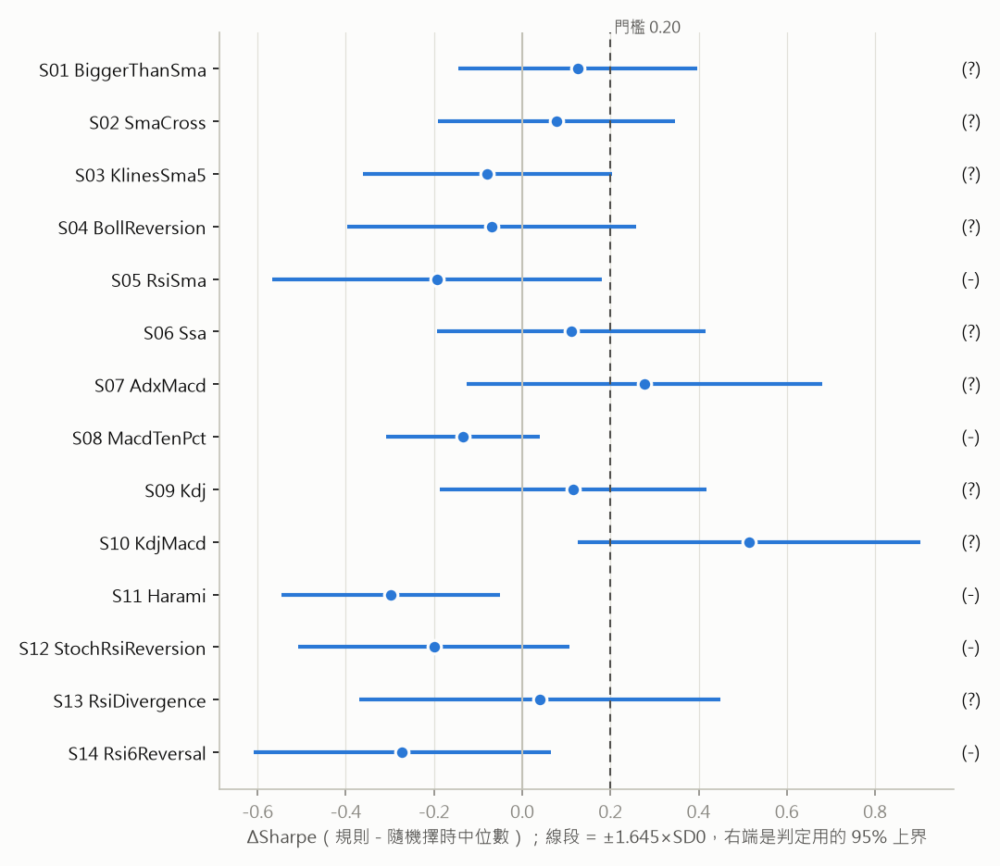
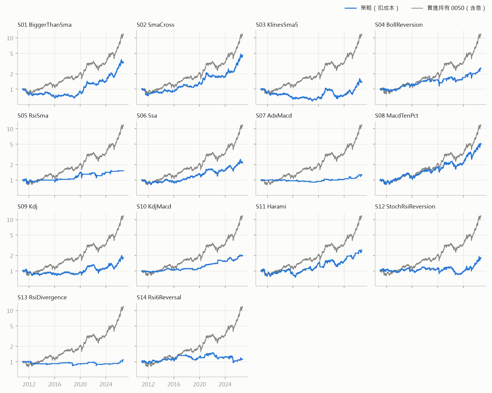
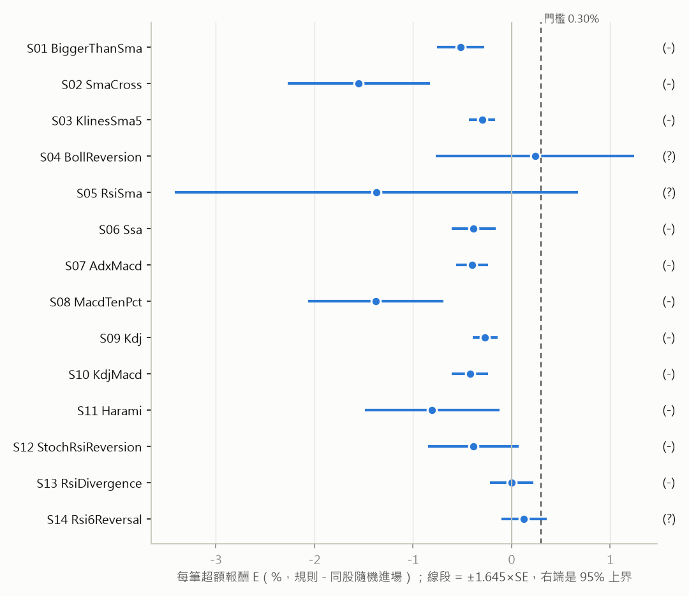
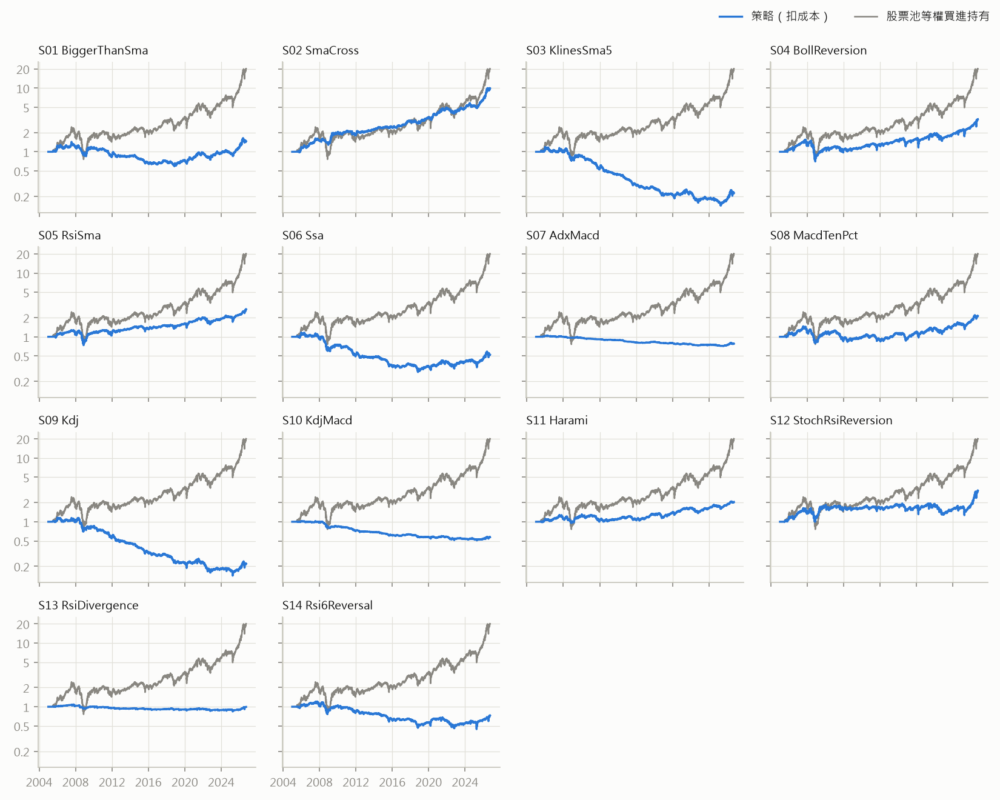
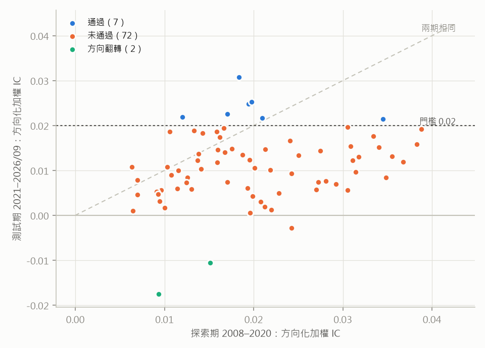
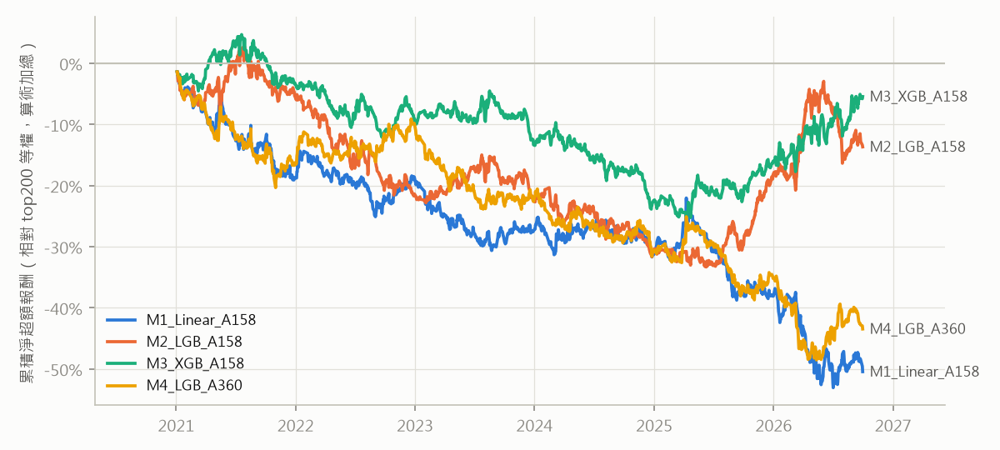

# 台股：Qbot 策略回測與因子挖掘

由 `qbot/tw_research/report.py` 產生；數字以程式輸出為準。方法、移植差異與解讀見 `docs/03-智能策略/台股策略回測與因子挖掘.md`。

<b>預先承諾（原文，寫於任何結果計算之前）</b>

（原文複製自 claude-notes/journal/2026-10-03-Qbot策略與因子挖掘移植台股-預先承諾.md，寫定於任何策略報酬或因子 IC 計算之前；之後只能修程式錯誤，不得修改本段。）

## 本輪目的

回答兩個問題：
(A) Qbot repo 內附的擇時策略，**照原參數**搬到台股、扣散戶成本後，相對「同曝險、同持有分布的隨機擇時」有沒有穩定優勢；
(B) Qbot 的因子挖掘流程（qlib Alpha158 / Alpha360 + 模型 + TopkDropout）在台股能不能挖到通過樣本外檢驗的因子與組合。

**不是**找最佳參數、**不是**挑最好的模型。所有策略與模型都用 repo 原本的參數；任何導向「哪個參數／模型最好」的做法都是本輪的失敗。

## 我相信什麼

- **A-T1（0050 擇時）**：14 項沒有 (+)，多數為 (?)（約 15.7 年單一序列，可偵測門檻太大）。
- **A-T2（個股波段）**：沒有 (+)；換手最高的 S03（5 日均線）、S09（KDJ）、S14（RSI6）為 (−)。
- **B1（單因子）**：有因子通過，預期 10–40 個，以短期反轉、波動度、成交量相關為主，測試期方向化加權 |IC| 落在 0.02–0.05。
- **B2（多因子）**：四個模型的測試期 rank IC 顯著，但主設定（每日換掉 5/50 檔）扣成本後年化淨超額 < 2%，判 (−)；
  GBDT 對線性基準的每日 IC 差不顯著。

## 為什麼相信

- **成本算式（不需要資料）**：TopkDropout topk=50、n_drop=5 每天賣出、買進各約 10% 的部位，
  每日成本 ≈ 0.1×0.0399% + 0.1×0.3399% ≈ 0.038%，年化約 9.6%。毛超額要先贏過這個數字。
- 經典技術規則在成熟市場扣除資料探勘偏誤後多半不顯著（憑記憶，未在本輪重讀）。
- `python_AlphaGPT` 的台股公式挖掘結論（已讀 `alphagpt_tw_summary.md`）：point-in-time 宇宙找不到通過樣本外的因子。
  但那是 top-10 持有的組合績效；本輪 B1 量的是全橫斷面 IC，兩者可以方向相反（cross-sectional-selection §1）。
- **已看過的資料，在此揭露**（為了資料稽核，沒有計算任何訊號報酬或 IC）：
  0050 在 2009 Q1、2013-12～2014-01、2014-10、2012-10 的幾段價格，以及 2013–2026 每次配息日前後的收盤價
  （因此知道 0050 從 2025-06 約 47 元漲到 2026-09 約 112 元）；加權指數 2026-09-29～10-01 收盤；2330 最後兩天收盤；
  top100 股票池的規模（719 檔）與超過漲跌幅的跳動次數（861 次）；2009–2011 每季 0050 與加權指數的最大日報酬差。

## 資料（看結果前固定）

- **個股**：Yahoo 日線（`qbot/data/tw_collector.py`），清單取自 `python_AlphaGPT/tw_stock.db` 的 tokens 表
  （2026-10-02 仍上市櫃的 1,974 檔普通股；FinMind 匿名請求回 402），下載成功 1,962 檔，2005-01-03 至 2026-10-01，
  研究截止 **2026-09-30**。**不含已下市股票：存活者偏差。**
- **0050**：Yahoo 的 0050 不可用（2014-01-02 有 −75% 的分割調整錯誤、2013 年以前無配息、2014 年配息單位錯、2009 Q1 有
  ±12% 日報酬），改用證交所 `STOCK_DAY`（只提供 2010-01-04 以後）＋ `TWT49U` 除權息參考價自建含息還原價；
  2025-06-18 的 1 拆 4 分割手動列出，並以前後價格比驗證。
- **資料清理**（稽核後、看結果前定）：「無法解釋的跳動」= 收盤或開盤相對前一日收盤超過制度上限
  （2015-06-01 前 7%、之後 10%）＋0.5 個百分點。T2：持有期間碰到的交易剔除，隨機對照也不抽碰到的區間；
  B1：label 設為缺值；B2：不處理（qlib 回測照原資料），報告揭露。

## 定義（看結果前固定）

### 共同

- **成交**（A）：t 日收盤算訊號，t+1 日開盤成交。開盤相對前收 ≥ 9.5%（2015-06-01 前 6.5%）視為漲停，買進作廢、
  隔天由規則重新判斷；≤ −9.5%（−6.5%）視為跌停，賣出順延到下一個非跌停的開盤。
- **散戶參照成本**：手續費 0.1425% × 0.28 每邊、最低 20 元；證交稅賣出時普通股 0.3%、ETF 0.1%。
  來回：個股 0.3798%、ETF 0.1798%。集合競價成交，不加滑價。
- 全額買進（整股、可零股），空手報酬為 0，只做多。數值以 `qbot/tw_research/config.py` 為準。

### A：策略（14 條，原參數；移植差異見 `docs/03-智能策略/台股策略回測與因子挖掘.md`）

S01 收盤 > SMA15（bigger_than_ema_bt）、S02 SMA10/30 交叉（sma_cross_strategy_bt）、S03 收盤 > SMA5（klines_bt）、
S04 布林(13) 均值回歸（boll_strategy_bt）、S05 RSI 穿 50 + SMA15（multi_strategy_bt）、S06 SSA(15)（ssa_strategy_bt）、
S07 EMA13/55/89 + ADX + MACD 柱持有 3 天（adx_strategy）、S08 MACD(12,26,5) 金叉、±10% 出場（tutorials 02）、
S09 KDJ 金叉／死叉（tutorials 04 kdj）、S10 MACD 金叉買、KDJ 死叉賣（tutorials 04 kdj_macd）、S11 孕線、±10% 出場（tutorials 07）、
S12 StochRSI 均值回歸只做多（pytrader StochRSI）、S13 RSI 背離只做多（pytrader rsi_departure_strategy）、
S14 RSI6 反轉＋23 日均價停損，日 K（pytrader CCI.py）。
沒有移植的 12 個檔案與原因列在 `strategies.NOT_PORTED`（無交易規則、前視偏差、無法執行、需要基本面或分 K）。

### T1：0050 擇時（N = 14）

- 0050 自 2010-01-04 起，前 250 根暖身不計，評估期約 2011-01 至 2026-09-30。
- 報酬：開盤到開盤；進場日扣買進成本、出場日扣賣出成本。規則與對照用同一個式子。
- **對照**：規則實際的持有段、空手段各自隨機重排 2,000 次（保留交易次數、曝險、持有天數分布，只拿掉時機）。
- E = ΔSharpe = 規則淨 Sharpe −（對照淨 Sharpe 中位數）；p =（1 + 對照 ≥ 規則的次數）/（2,000 + 1）；
  SD₀ = 對照 Sharpe 標準差；可偵測門檻 MDE = 2·SD₀，報告列出。
- 兩軌：A = 評估起點至 2015-05-31，B = 2015-06-01 至 2026-09-30，各軌內獨立重排。
- 正年度比例：各年「規則淨對數報酬 − 對照該年中位數」> 0 的比例，只計有持有的年度。
- 集中度：剔除淨報酬最大的 3 筆交易後，其餘交易淨對數報酬總和 > 0。

### T2：個股波段（N = 14）

- 股票池：每季最後一個交易日依過去 60 日平均成交金額取前 100 名（point-in-time，隔日生效）；只有成分期間能進場，出場不受限。
- 單位：已平倉交易；淨報酬 = 開盤到開盤、扣來回成本。
- **對照**：同一檔股票、同持有天數，在實際進場日前後 250 個交易日內隨機進場 50 次（排除開盤漲停日與碰到跳動的區間）的平均淨報酬。
  超額 = 實際 − 對照平均。
- 推論：依進場月份取當月交易的平均超額成月序列；**E = 月序列平均**；Newey-West t（lag 6），單尾。
- 兩軌依進場日：A = 至 2015-05-31，B = 2015-06-01 起。
- 正年度比例：年度平均超額 > 0 的比例。集中度：剔除淨報酬最大的 1% 交易後 E 仍 > 0。

### B1：單因子篩選（alphalens 式 IC 分析）

- Alpha158 的 158 個原始特徵（不做前處理），股票池 top200（同 T2 的規則取前 200 名）；label = Ref($close,−2)/Ref($close,−1)−1，經資料清理。
- 每日橫斷面 Spearman IC，當日至少 30 檔才計；z = IC·√(K−1)。
- **探索期** 2008-01-01～2020-12-31：|NW t(z)|（lag 5）≥ 3.0 → 候選，方向 = t 的符號。
- **測試期** 2021-01-01～2026-09-30（只看一次）：方向化 t 的單尾 p，對全部候選做 Holm（5%）；
  效果量 = (K−1) 加權 IC，方向化後須 ≥ 0.02。
- 「通過」= 候選 ∧ Holm 拒絕 ∧ 達門檻 → 因子庫。方向化 t 的反向單尾 p < 0.025 → 「方向翻轉」。

### B2：多因子模型（N = 4）

- M1 Linear(OLS)＋Alpha158（基準）、M2 LightGBM＋Alpha158、M3 XGBoost＋Alpha158、M4 LightGBM＋Alpha360；
  參數照 `pytrader/strategies/benchmarks` 的 yaml（只改執行緒數、加固定 seed）。
- 切分：train 2008–2017、valid 2018–2020、test 2021-01-01～2026-09-30；股票池 top200。
- 回測：qlib TopkDropout（topk 50、n_drop 5）、收盤價成交、region tw（一張 1000 股）、帳戶 10 億、漲跌停門檻 9.5%、成本同上。
- 訊號：測試期每日 rank IC（預測 vs label）的 z 平均，NW t（lag 5）單尾，4 個模型 Holm。
- 組合：每日淨報酬 − top200 等權（依當日成分）報酬 = 超額；年化 = 平均 × 252；NW t（lag 5）單尾。

## 判準 —— 和假設同一個 commit，每項各自分類

**A（T1、T2 各 14 項，各軌內 Holm，族系錯誤率 5%）**，材料性門檻 M：T1 為 ΔSharpe 0.20，T2 為每筆超額 0.30%。

- **(+) 支持**：Holm 後拒絕 ∧ E ≥ M ∧ 兩軌 E 都 > 0 ∧ 正年度比例 ≥ 60% ∧ 集中度通過。
- **(−) 無效果**：E 的 95% 單尾上界 < M（T1：ΔSharpe + 1.645·SD₀；T2：E + 1.645·NW 標準誤）。
- **(?) 無法回答**：其他。報告必須寫「檢定力不足」，不得寫「無效」。
- 不設尖峰否決：每條策略只有 repo 的一組參數，沒有鄰居可比。

**B1**：每個候選因子為「通過／未通過／方向翻轉」；非候選不判定。

**B2（每個模型）**：

- **(+)**：訊號 Holm 拒絕 ∧ 年化淨超額 ≥ 2% ∧ 超額單尾 p < 0.05 ∧ 測試期前後兩半（2021–2023、2024–2026-09）年化超額都 > 0。
- **(−)**：年化淨超額的 95% 單尾上界 < 2%。
- **(?)**：其他。
- 基準診斷（不改判定）：M2–M4 對 M1 的每日 IC 差（NW t），依 cross-sectional-selection §3 解讀。

**敏感度（只報告，不改判定）**：B2 手續費 0、手續費不打折、n_drop 1 與 2。
**描述（不判定）**：0050 買進持有的 CAGR／Sharpe／最大回撤並列曝險與換手；T2 的等權彙總組合；
B2 的「0050 → top200 等權 → top-k」分解；B1 通過因子的測試期五分位平均報酬（alphalens）。

**禁止事項**：

- 不得輸出「建議使用 X」，除非它是 (+)。
- 判定只用主設定；看到結果後不得更改判準、資料清理規則、策略或模型參數。
- 程式錯誤可以修，修正要寫進報告，並註明修正是否改變判定。
- 任何 (+) 都不得直接上實盤，必須先另立前瞻保留段（凍結後才產生的資料）的預先承諾。

## 我可能錯在哪

- **存活者偏差**：清單只有現存公司。T2 的絕對報酬偏高，但超額是「同一檔股票的規則 vs 隨機進場」，受影響較小；
  B 的等權基準也同樣偏，超額比較相對公平，但避開下市股的效果會灌進所有組合。
- **Yahoo 資料品質**：跳動規則只抓得到超過漲跌幅的錯價，抓不到幅度小的錯誤；B2 沒有做清理。
- **T1 只有約 15.7 年一條序列**，MDE 可能大到任何合理效果都落在 (?)；2008 年不在樣本裡（證交所 API 限制），
  趨勢類規則最有利的一段因此缺席。Track A 只有約 4.4 年。
- **B2 的收盤價成交與 10 億帳戶**：每檔約 2,000 萬，對 top200 尾端的流動性可能偏大；沒有衝擊成本模型。
- **移植差異**：KDJ 兩條的賣出條件改為死叉（原始碼的 or 會讓每筆只持有一天）、RSI 背離修正 lows 欄的 bug、
  CCI.py 從分 K 改成日 K、部位一律全額。這些是判斷，報告列出。
- **與 `python_技術分析`（2026-10-02 預先承諾）重疊**：該案 T1 也是 0050 擇時，規則類似但參數與定義不同。
  本輪的 0050 結果會比該案先被看到；該案判準已凍結並推送，本輪結果不得用來修改該案的任何輸入。

## A-T1：0050 擇時

評估期 2010-12-31 ～ 2026-09-30（0050 證交所資料 2010-01-04 起，前 250 根暖身）。
資料中超過漲跌幅的跳動：0 天。

**判定：(?) × 9, (−) × 5。**

買進持有 0050（含息、扣一次買進成本）：CAGR 17.61%、Sharpe 0.995、最大回撤 -33.94%。

| 代號 | 策略 | 淨 Sharpe | 對照中位數 | ΔSharpe | SD₀ | MDE | p | Holm p | 軌 A Δ | 軌 B Δ | 正年度 | 集中度 | 上界 | 判定 |
|---|---|---|---|---|---|---|---|---|---|---|---|---|---|---|
| S01 | BiggerThanSma | 0.705 | 0.579 | 0.126 | 0.165 | 0.330 | 0.230 | 1.000 | -0.666 | 0.339 | 29% | 通過 | 0.397 | (?) |
| S02 | SmaCross | 0.820 | 0.742 | 0.078 | 0.164 | 0.327 | 0.335 | 1.000 | -0.425 | 0.231 | 47% | 通過 | 0.347 | (?) |
| S03 | KlinesSma5 | 0.239 | 0.318 | -0.079 | 0.172 | 0.344 | 0.673 | 1.000 | -0.437 | 0.027 | 29% | 未通過 | 0.204 | (?) |
| S04 | BollReversion | 0.538 | 0.607 | -0.070 | 0.199 | 0.398 | 0.634 | 1.000 | 0.170 | -0.159 | 50% | 通過 | 0.258 | (?) |
| S05 | RsiSma | 0.324 | 0.517 | -0.193 | 0.228 | 0.455 | 0.810 | 1.000 | -0.231 | -0.188 | 57% | 未通過 | 0.181 | (−) |
| S06 | Ssa | 0.517 | 0.406 | 0.111 | 0.185 | 0.370 | 0.281 | 1.000 | -0.050 | 0.158 | 56% | 通過 | 0.415 | (?) |
| S07 | AdxMacd | 0.329 | 0.051 | 0.277 | 0.245 | 0.491 | 0.138 | 1.000 | 0.013 | 0.368 | 56% | 通過 | 0.681 | (?) |
| S08 | MacdTenPct | 0.763 | 0.897 | -0.134 | 0.106 | 0.212 | 0.902 | 1.000 | 0.101 | -0.180 | 41% | 通過 | 0.040 | (−) |
| S09 | Kdj | 0.380 | 0.264 | 0.116 | 0.184 | 0.367 | 0.259 | 1.000 | 0.036 | 0.119 | 47% | 通過 | 0.418 | (?) |
| S10 | KdjMacd | 0.717 | 0.202 | 0.515 | 0.236 | 0.472 | 0.018 | 0.252 | 0.402 | 0.593 | 69% | 通過 | 0.903 | (?) |
| S11 | Harami | 0.521 | 0.819 | -0.298 | 0.151 | 0.302 | 0.979 | 1.000 | -0.223 | -0.272 | 41% | 通過 | -0.050 | (−) |
| S12 | StochRsiReversion | 0.349 | 0.550 | -0.200 | 0.187 | 0.375 | 0.865 | 1.000 | 0.156 | -0.326 | 41% | 通過 | 0.108 | (−) |
| S13 | RsiDivergence | 0.119 | 0.079 | 0.040 | 0.248 | 0.497 | 0.426 | 1.000 | -0.306 | 0.203 | 69% | 未通過 | 0.449 | (?) |
| S14 | Rsi6Reversal | 0.123 | 0.395 | -0.272 | 0.205 | 0.410 | 0.916 | 1.000 | 0.240 | -0.440 | 56% | 未通過 | 0.065 | (−) |

描述統計（開盤到開盤、扣成本；最後一欄是 backtrader 淨值算的 CAGR，用來交叉核對報酬口徑）：

| 代號 | 策略 | CAGR | Sharpe | 最大回撤 | 曝險 | 來回/年 | 交易數 | backtrader CAGR |
|---|---|---|---|---|---|---|---|---|
| S01 | BiggerThanSma | 8.25% | 0.705 | -34.55% | 61% | 15.3 | 232 | 8.15% |
| S02 | SmaCross | 10.44% | 0.820 | -28.31% | 64% | 4.2 | 63 | 10.34% |
| S03 | KlinesSma5 | 2.22% | 0.239 | -43.28% | 57% | 32.6 | 497 | 2.14% |
| S04 | BollReversion | 6.36% | 0.538 | -28.73% | 44% | 3.7 | 56 | 6.35% |
| S05 | RsiSma | 2.75% | 0.324 | -23.12% | 31% | 1.3 | 20 | 2.75% |
| S06 | Ssa | 5.29% | 0.517 | -28.15% | 48% | 19.3 | 295 | 5.28% |
| S07 | AdxMacd | 1.57% | 0.329 | -10.83% | 11% | 9.6 | 146 | 1.55% |
| S08 | MacdTenPct | 11.34% | 0.763 | -29.79% | 85% | 2.2 | 33 | 11.24% |
| S09 | Kdj | 3.95% | 0.380 | -32.24% | 51% | 31.3 | 478 | 3.88% |
| S10 | KdjMacd | 4.59% | 0.717 | -16.51% | 18% | 10.0 | 152 | 4.58% |
| S11 | Harami | 6.30% | 0.521 | -32.44% | 72% | 2.2 | 32 | 6.21% |
| S12 | StochRsiReversion | 3.96% | 0.349 | -29.52% | 49% | 9.8 | 150 | 3.90% |
| S13 | RsiDivergence | 0.54% | 0.119 | -18.58% | 9% | 6.4 | 98 | 0.54% |
| S14 | Rsi6Reversal | 0.75% | 0.123 | -35.86% | 39% | 14.1 | 216 | 0.75% |

## A-T2：個股波段（每季流動性前 100 名）

**判定：(?) × 3, (−) × 11。**

執行失敗的（股票, 策略）組合：0 個。 持有期間碰到不可能跳動而剔除的交易數列在「剔除（跳動）」欄。

| 代號 | 策略 | 交易數 | 剔除（跳動） | 平均持有天數 | 每筆淨報酬 | E（月平均超額） | t | Holm p | 軌 A E | 軌 B E | 正年度 | 集中度 | 上界 | 判定 |
|---|---|---|---|---|---|---|---|---|---|---|---|---|---|---|
| S01 | BiggerThanSma | 37333 | 417 | 7.2 | -0.00% | -0.52% | -3.55 | 1.000 | -0.62% | -0.43% | 18% | 未通過 | -0.28% | (−) |
| S02 | SmaCross | 9241 | 331 | 26.8 | 2.15% | -1.55% | -3.54 | 1.000 | -1.10% | -1.95% | 32% | 未通過 | -0.83% | (−) |
| S03 | KlinesSma5 | 69949 | 406 | 3.8 | -0.25% | -0.30% | -3.73 | 1.000 | -0.29% | -0.31% | 23% | 未通過 | -0.17% | (−) |
| S04 | BollReversion | 7448 | 293 | 33.4 | 1.66% | 0.24% | 0.39 | 1.000 | 0.77% | -0.23% | 41% | 未通過 | 1.25% | (?) |
| S05 | RsiSma | 2697 | 258 | 93.1 | 3.95% | -1.37% | -1.10 | 1.000 | 1.45% | -3.83% | 59% | 未通過 | 0.67% | (?) |
| S06 | Ssa | 41633 | 368 | 6.1 | -0.19% | -0.38% | -2.84 | 1.000 | -0.44% | -0.34% | 18% | 未通過 | -0.16% | (−) |
| S07 | AdxMacd | 14755 | 76 | 3.0 | -0.19% | -0.40% | -4.06 | 1.000 | -0.31% | -0.48% | 18% | 未通過 | -0.24% | (−) |
| S08 | MacdTenPct | 12878 | 371 | 26.1 | 0.57% | -1.38% | -3.30 | 1.000 | -1.21% | -1.53% | 23% | 未通過 | -0.69% | (−) |
| S09 | Kdj | 64550 | 388 | 3.9 | -0.26% | -0.27% | -3.54 | 1.000 | -0.24% | -0.30% | 23% | 未通過 | -0.14% | (−) |
| S10 | KdjMacd | 19676 | 106 | 4.0 | -0.32% | -0.42% | -3.76 | 1.000 | -0.49% | -0.37% | 14% | 未通過 | -0.24% | (−) |
| S11 | Harami | 8445 | 227 | 28.6 | 0.81% | -0.81% | -1.94 | 1.000 | -0.58% | -1.01% | 32% | 未通過 | -0.12% | (−) |
| S12 | StochRsiReversion | 20465 | 402 | 13.0 | 0.52% | -0.39% | -1.39 | 1.000 | 0.14% | -0.85% | 32% | 未通過 | 0.07% | (−) |
| S13 | RsiDivergence | 12274 | 90 | 4.2 | -0.09% | -0.00% | -0.00 | 1.000 | 0.05% | -0.04% | 36% | 未通過 | 0.22% | (−) |
| S14 | Rsi6Reversal | 36258 | 283 | 5.7 | -0.09% | 0.13% | 0.91 | 1.000 | 0.25% | 0.02% | 32% | 未通過 | 0.35% | (?) |

描述（不判定）：把每檔股票在成分期間的策略日報酬等權平均成一個組合（空手部位報酬為 0），2006 年起：

| 組合 | CAGR | Sharpe | 最大回撤 |
|---|---|---|---|
| 股票池等權 | 14.51% | 0.626 | -68.97% |
| S01 BiggerThanSma | 0.95% | 0.138 | -58.72% |
| S02 SmaCross | 11.27% | 0.923 | -21.26% |
| S03 KlinesSma5 | -7.79% | -0.528 | -87.97% |
| S04 BollReversion | 5.59% | 0.392 | -54.56% |
| S05 RsiSma | 4.59% | 0.429 | -41.80% |
| S06 Ssa | -3.78% | -0.214 | -76.01% |
| S07 AdxMacd | -1.37% | -0.551 | -30.88% |
| S08 MacdTenPct | 3.08% | 0.295 | -45.62% |
| S09 Kdj | -7.83% | -0.511 | -87.71% |
| S10 KdjMacd | -2.80% | -0.514 | -50.52% |
| S11 Harami | 3.13% | 0.390 | -25.21% |
| S12 StochRsiReversion | 4.97% | 0.354 | -38.89% |
| S13 RsiDivergence | -0.12% | -0.002 | -22.30% |
| S14 Rsi6Reversal | -1.82% | -0.082 | -63.14% |

## B1：Alpha158 單因子篩選

158 個因子中探索期 |t(z)| ≥ 3.0 的候選 81 個；
測試期結果：未通過 72, 通過 7, 方向翻轉 2。
label 超過漲跌幅的不可能報酬設為缺值：379 筆（全部 911082 筆）。

| 因子 | 方向 | 探索 IC | 探索 t | 測試 IC | 測試 t（方向化） | Holm p | 狀態 |
|---|---|---|---|---|---|---|---|
| CORR20 | − | -0.019 | -9.7 | -0.025 | +8.14 | 0.000 | 通過 |
| CORR30 | − | -0.020 | -9.7 | -0.025 | +8.03 | 0.000 | 通過 |
| CORR10 | − | -0.021 | -11.0 | -0.022 | +7.26 | 0.000 | 通過 |
| KUP | − | -0.012 | -6.1 | -0.022 | +6.58 | 0.000 | 通過 |
| CORR60 | − | -0.017 | -8.2 | -0.023 | +6.54 | 0.000 | 通過 |
| CORD20 | − | -0.016 | -7.7 | -0.019 | +6.27 | 0.000 | 未通過 |
| KLEN | − | -0.018 | -6.5 | -0.031 | +6.23 | 0.000 | 通過 |
| CORR5 | − | -0.024 | -13.4 | -0.017 | +5.80 | 0.000 | 未通過 |
| CORD60 | − | -0.017 | -7.6 | -0.019 | +5.74 | 0.000 | 未通過 |
| CORD30 | − | -0.016 | -7.8 | -0.017 | +5.66 | 0.000 | 未通過 |
| MIN5 | + | +0.034 | +13.6 | +0.021 | +5.25 | 0.000 | 通過 |
| CORD10 | − | -0.018 | -9.1 | -0.015 | +5.06 | 0.000 | 未通過 |
| CORD5 | − | -0.025 | -14.0 | -0.013 | +4.82 | 0.000 | 未通過 |
| QTLD5 | + | +0.039 | +15.2 | +0.019 | +4.76 | 0.000 | 未通過 |
| MIN10 | + | +0.031 | +11.8 | +0.020 | +4.53 | 0.000 | 未通過 |
| RESI10 | − | -0.033 | -13.8 | -0.018 | +4.43 | 0.000 | 未通過 |
| LOW0 | + | +0.027 | +12.4 | +0.014 | +4.12 | 0.001 | 未通過 |
| MA5 | + | +0.038 | +14.2 | +0.016 | +3.86 | 0.004 | 未通過 |
| BETA5 | − | -0.031 | -11.6 | -0.015 | +3.76 | 0.006 | 未通過 |
| STD5 | − | -0.011 | -4.0 | -0.019 | +3.75 | 0.006 | 未通過 |
| STD10 | − | -0.013 | -4.7 | -0.019 | +3.72 | 0.006 | 未通過 |
| QTLD10 | + | +0.034 | +12.7 | +0.015 | +3.71 | 0.006 | 未通過 |
| VSUMP5 | − | -0.006 | -3.5 | -0.011 | +3.61 | 0.009 | 未通過 |
| VSUMN5 | + | +0.006 | +3.5 | +0.011 | +3.61 | 0.009 | 未通過 |
| VSUMD5 | − | -0.006 | -3.5 | -0.011 | +3.61 | 0.009 | 未通過 |
| IMAX5 | − | -0.020 | -9.7 | -0.011 | +3.41 | 0.019 | 未通過 |
| RANK5 | − | -0.037 | -15.4 | -0.012 | +3.33 | 0.025 | 未通過 |
| RESI20 | − | -0.036 | -14.6 | -0.013 | +3.27 | 0.030 | 未通過 |
| STD60 | − | -0.014 | -4.2 | -0.018 | +3.26 | 0.030 | 未通過 |
| MIN20 | + | +0.021 | +8.1 | +0.015 | +3.24 | 0.032 | 未通過 |
| KLOW | − | -0.012 | -6.0 | -0.010 | +3.10 | 0.051 | 未通過 |
| ROC5 | + | +0.032 | +11.6 | +0.013 | +3.09 | 0.051 | 未通過 |
| MIN30 | + | +0.019 | +6.9 | +0.013 | +2.99 | 0.070 | 未通過 |
| WVMA20 | − | -0.007 | -4.0 | -0.008 | +2.97 | 0.073 | 未通過 |
| MIN60 | + | +0.017 | +6.0 | +0.014 | +2.94 | 0.079 | 未通過 |
| QTLD20 | + | +0.020 | +7.0 | +0.012 | +2.85 | 0.102 | 未通過 |
| MA10 | + | +0.031 | +10.8 | +0.012 | +2.81 | 0.113 | 未通過 |
| IMXD5 | − | -0.024 | -10.7 | -0.009 | +2.70 | 0.156 | 未通過 |
| STD30 | − | -0.016 | -4.9 | -0.015 | +2.68 | 0.160 | 未通過 |
| QTLD30 | + | +0.016 | +5.5 | +0.012 | +2.65 | 0.173 | 未通過 |
| QTLD60 | + | +0.014 | +4.6 | +0.012 | +2.63 | 0.176 | 未通過 |
| STD20 | − | -0.014 | -4.5 | -0.014 | +2.56 | 0.213 | 未通過 |
| RANK10 | − | -0.031 | -12.0 | -0.010 | +2.51 | 0.241 | 未通過 |
| RESI30 | − | -0.022 | -8.8 | -0.010 | +2.47 | 0.257 | 未通過 |
| RESI60 | − | -0.010 | -3.7 | -0.011 | +2.47 | 0.257 | 未通過 |
| MA20 | + | +0.014 | +4.6 | +0.010 | +2.23 | 0.462 | 未通過 |
| WVMA5 | − | -0.010 | -6.5 | -0.006 | +2.22 | 0.462 | 未通過 |
| KMID2 | − | -0.027 | -12.8 | -0.007 | +2.08 | 0.647 | 未通過 |
| QTLU5 | + | +0.035 | +12.6 | +0.008 | +2.03 | 0.695 | 未通過 |
| WVMA10 | − | -0.009 | -5.7 | -0.005 | +2.03 | 0.695 | 未通過 |
| ROC10 | + | +0.013 | +4.4 | +0.008 | +1.94 | 0.808 | 未通過 |
| MA30 | + | +0.011 | +3.4 | +0.009 | +1.89 | 0.882 | 未通過 |
| IMIN5 | + | +0.019 | +9.1 | +0.006 | +1.86 | 0.924 | 未通過 |
| RANK20 | − | -0.017 | -6.1 | -0.007 | +1.83 | 0.942 | 未通過 |
| RSV5 | − | -0.029 | -11.1 | -0.007 | +1.82 | 0.942 | 未通過 |
| QTLU10 | + | +0.028 | +9.5 | +0.008 | +1.74 | 1.000 | 未通過 |
| SUMP5 | − | -0.027 | -10.8 | -0.006 | +1.53 | 1.000 | 未通過 |
| SUMD5 | − | -0.027 | -10.8 | -0.006 | +1.53 | 1.000 | 未通過 |
| SUMN5 | + | +0.027 | +10.8 | +0.006 | +1.53 | 1.000 | 未通過 |
| QTLU20 | + | +0.012 | +3.9 | +0.007 | +1.53 | 1.000 | 未通過 |
| IMAX10 | − | -0.007 | -3.3 | -0.005 | +1.45 | 1.000 | 未通過 |
| RANK30 | − | -0.011 | -4.0 | -0.006 | +1.42 | 1.000 | 未通過 |
| KMID | − | -0.031 | -12.6 | -0.006 | +1.37 | 1.000 | 未通過 |
| OPEN0 | + | +0.031 | +12.6 | +0.006 | +1.37 | 1.000 | 未通過 |
| IMXD10 | − | -0.009 | -4.0 | -0.005 | +1.32 | 1.000 | 未通過 |
| BETA10 | − | -0.013 | -4.7 | -0.006 | +1.32 | 1.000 | 未通過 |
| RSV10 | − | -0.023 | -8.2 | -0.005 | +1.20 | 1.000 | 未通過 |
| RESI5 | − | -0.020 | -8.3 | -0.004 | +1.12 | 1.000 | 未通過 |
| CNTP5 | − | -0.021 | -10.2 | -0.003 | +1.01 | 1.000 | 未通過 |
| SUMD10 | − | -0.009 | -3.6 | -0.003 | +0.79 | 1.000 | 未通過 |
| SUMN10 | + | +0.009 | +3.6 | +0.003 | +0.79 | 1.000 | 未通過 |
| SUMP10 | − | -0.009 | -3.6 | -0.003 | +0.79 | 1.000 | 未通過 |
| CNTD5 | − | -0.021 | -9.9 | -0.002 | +0.62 | 1.000 | 未通過 |
| RSV20 | − | -0.010 | -3.4 | -0.002 | +0.39 | 1.000 | 未通過 |
| KSFT2 | − | -0.022 | -10.1 | -0.001 | +0.34 | 1.000 | 未通過 |
| RSQR60 | + | +0.006 | +3.2 | +0.001 | +0.29 | 1.000 | 未通過 |
| CNTN5 | + | +0.020 | +9.1 | +0.001 | +0.20 | 1.000 | 未通過 |
| VWAP0 | + | +0.024 | +9.9 | -0.003 | -0.71 | 1.000 | 未通過 |
| KSFT | − | -0.024 | -9.9 | +0.003 | -0.73 | 1.000 | 未通過 |
| MAX5 | + | +0.015 | +4.8 | -0.011 | -2.19 | 1.000 | 方向翻轉 |
| HIGH0 | + | +0.009 | +3.5 | -0.017 | -4.01 | 1.000 | 方向翻轉 |

通過因子在測試期的五分位平均日報酬（相對當日平均，bp；alphalens `mean_return_by_quantile`，已依方向化，Q5 為 IC 預期最好的一組）。rank IC 量的是名次（接近中位數），等權持有賺的是平均數；兩者方向不同時，表示右尾（漲停）集中在 IC 預期較差的那組（cross-sectional-selection §1）：

|  | Q1 | Q2 | Q3 | Q4 | Q5 | Q5−Q1 | 平均數與 IC 同向 |
|---|---|---|---|---|---|---|---|
| KLEN | 1.01 | 1.89 | 0.07 | -1.16 | -1.79 | -2.8 | **否** |
| KUP | -1.3 | 0.4 | -0.08 | 0.08 | 0.91 | 2.21 | 是 |
| MIN5 | 0.93 | -0.06 | 0.14 | 0.33 | -1.33 | -2.26 | **否** |
| CORR10 | -2.87 | 0.85 | 0.34 | 2.37 | -0.69 | 2.18 | 是 |
| CORR20 | -1.15 | -2.18 | 1.05 | 0.77 | 1.54 | 2.69 | 是 |
| CORR30 | -1.22 | -2.21 | -0.06 | 1.56 | 1.93 | 3.16 | 是 |
| CORR60 | -0.03 | -3.52 | 0.11 | 1.27 | 2.17 | 2.2 | 是 |

## B2：qlib 多因子模型（TopkDropout topk 50、n_drop 5）

**判定：(?) × 2, (−) × 2。**

| 模型 | 測試期 IC（加權） | ICIR | IC t | IC Holm p | 年化毛超額 | 年化成本 | 年化淨超額 | t | 前半 | 後半 | 上界 | 判定 |
|---|---|---|---|---|---|---|---|---|---|---|---|---|
| M1_Linear_A158 | +0.0311 | 0.212 | 8.43 | 0.000 | 0.06% | 9.20% | -9.14% | -2.60 | -9.49% | -8.77% | -3.36% | (−) |
| M2_LGB_A158 | +0.0118 | 0.095 | 3.78 | 0.000 | 6.65% | 9.12% | -2.48% | -0.64 | -7.81% | 3.39% | 3.84% | (?) |
| M3_XGB_A158 | +0.0167 | 0.139 | 5.27 | 0.000 | 8.03% | 9.01% | -0.98% | -0.29 | -4.61% | 3.00% | 4.62% | (?) |
| M4_LGB_A360 | +0.0255 | 0.196 | 7.22 | 0.000 | 1.49% | 9.36% | -7.88% | -2.32 | -7.82% | -7.94% | -2.29% | (−) |

分解（cross-sectional-selection §0）：

| 組合（測試期） | CAGR | Sharpe | 最大回撤 |
|---|---|---|---|
| 0050（含息） | 30.43% | 1.276 | -33.83% |
| top200 等權 | 24.74% | 0.960 | -38.06% |
| M1_Linear_A158（top50，淨） | 15.24% | 0.749 | -40.31% |
| M2_LGB_A158（top50，淨） | 19.65% | 0.718 | -49.08% |
| M3_XGB_A158（top50，淨） | 21.78% | 0.786 | -45.16% |
| M4_LGB_A360（top50，淨） | 16.46% | 0.773 | -35.92% |

對線性基準 M1 的每日 rank IC 差（不改判定）：

- M2_LGB_A158：每日 IC 差 -0.0192（NW t -5.18）
- M3_XGB_A158：每日 IC 差 -0.0144（NW t -4.02）
- M4_LGB_A360：每日 IC 差 -0.0054（NW t -2.04）

敏感度（只報告，不改判定）：

| 模型（年化淨超額 vs 等權） | 主設定 | 手續費 0 | 手續費不打折 | n_drop=1 | n_drop=2 | 每日換手 |
|---|---|---|---|---|---|---|
| M1_Linear_A158 | -9.14% | -7.22% | -14.04% | 0.24% | -2.91% | 19.3% |
| M2_LGB_A158 | -2.48% | -0.49% | -7.43% | 8.93% | 5.32% | 19.1% |
| M3_XGB_A158 | -0.98% | 0.89% | -5.92% | -0.91% | 1.93% | 18.8% |
| M4_LGB_A360 | -7.88% | -5.88% | -12.94% | -2.06% | -5.35% | 19.6% |

## 沒有移植的策略

| 沒有移植的檔案 | 原因 |
|---|---|
| qbot/strategies/arbr_strategy.py | 只畫 AR/BR 指標，沒有進出場規則 |
| qbot/strategies/lstm_strategy_bt.py | 前視偏差：scaler 用全期資料 fit，且每天都拿測試集最後一筆的預測下單；ML 選股改由 B 部分的 qlib 流程檢驗 |
| qbot/strategies/rl_strategy_bt.py | 依賴不存在的 rlkit BacktraderEnv，self.model 從未建立，無法執行 |
| pytrader/strategies/lgb_strategy.py | label 寫成 close.shift(5)/close-1（過去報酬，不是未來報酬），且是 4 檔 A 股指數輪動；ML 選股改由 B 部分檢驗 |
| pytrader/strategies/svm_strategy.py | 同 lgb_strategy.py 的架構，依賴不存在的 model.svm 模組 |
| pytrader/strategies/q-learning.py | 用 A 股 5 分 K 訓練；台股沒有免費的長期分 K |
| pytrader/strategies/aroon_strategy.py | 在 28 個申萬行業指數間輪動，缺 TemplateStrategy 基底類別；台股沒有對應的免費產業指數日線 |
| pytrader/strategies/multi_factor.py | 聚寬平台腳本，需要市值、ROE 等基本面資料（Yahoo 沒有） |
| pytrader/strategies/multi_factor_strategy.py | 程式無法執行（PEFetcher 傳入參數順序錯、get_data 未用到 start/end），且需要基本面資料 |
| qbot/strategies/undervalued_stock_picking_strategy.py | 聚寬平台腳本，需要 PE、PB 等基本面資料 |
| pytrader/strategies/中概互联_自动T.py | 單一 A 股 ETF 的盤中做 T |
| pytrader/strategies/k-line.py / monte_carlo.py / example.py | 畫圖與範例，不是策略 |
