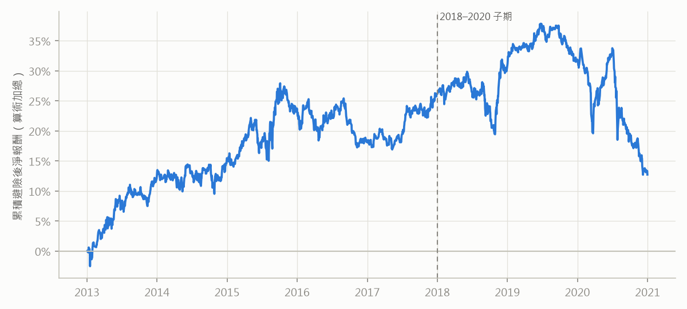

# 線性模型低換手＋0050 避險（walk-forward 2013–2020）

由 `qbot/tw_research/wf_hedge.py` 產生。

<b>預先承諾（原文，寫於任何 2013–2020 的模型預測或組合報酬計算之前）</b>

（原文複製自 claude-notes/journal/2026-10-04-Qbot線性模型低換手避險alpha-walk-forward-預先承諾.md，寫定於任何 2013–2020 的模型預測或組合報酬計算之前；之後只能修程式錯誤，不得修改本段。）

## 本輪目的

前一輪 B2 的**事後探索**（看過 2021–2026/09 測試期之後才算，不參與任何判定）發現：線性模型（OLS＋Alpha158）
挑的是低 beta 股票，原始超額接近 0，但扣掉 beta 後的毛 alpha 為正，且 IC 隨持有期上升（h=1 0.031 → h=60 0.059）。
本輪只回答一個問題：**這個 alpha 在沒看過的期間存在嗎？用低換手、以 0050 對沖 beta、扣完成本後，還剩多少？**

只檢驗一個設定（一個模型、一個換手、一個避險方式），不做任何參數或模型選擇。

## 我相信什麼

- 主判定為 **(?)**：避險後年化淨 alpha E 落在 −3% 到 +5% 之間，檢定力不足以區分。若判為 (+) 我會意外。
- 避險有效：避險後日報酬對 0050 的實現 beta 在 ±0.15 以內。
- 每日 rank IC 在 8 個年度中至少 6 年為正。

## 為什麼相信

- **可偵測門檻（寫判準前先算，只用已看過的 2021–2026 資料）**：同一模型 n_drop=1 的組合對 0050 回歸後的殘差，
  追蹤誤差年化 11.8%、NW 標準誤（5.75 年）5.0%。換算到 8 年約 4.2%，**MDE（2×SE）約 8.5%**；
  只用 2018–2020 三年則約 13.6%，所以改用 walk-forward（使用者 2026-10-04 選定）。
- 探索期的毛 alpha（對 top200 等權回歸）約 5–9%，但那是**對等權**、在大多頭、看過資料後的數字；
  本輪對 0050 避險，而 0050 以台積電為主，大型股相對等權的表現會直接進入 E。
- 存活者偏差會把多頭部位的報酬灌高（股票清單只有現存公司），0050 不受影響，所以 E 偏高（方向不利於保守）。
- **已看過的資料，在此揭露**：
  前一輪 B1 的 Alpha158 單因子 IC（2008–2020 合併，不分年）；T1 的 0050 淨值圖（2010–2026）與 T2 的股票池等權淨值圖
  （2005–2026）；B2 的 GBDT 用 2018–2020 做 early stopping（本輪是 OLS，不用 valid）。
  **從未計算任何模型在 2013–2020 的預測、IC 或組合報酬。**

## 資料（看結果前固定）

- 個股：前一輪的 Yahoo 日線與 qlib 資料（`~/.qlib/qlib_data/tw_data`），股票池 top200（每季依 60 日平均成交值取前 200 名，
  point-in-time）。**不做跳動清理**（與前一輪 B2 相同），報告揭露。
- 0050：證交所 `STOCK_DAY`＋`TWT49U` 自建的含息還原價（前一輪 T1 同一份，`twse.py`），用來算避險部位的報酬與個股 beta。

## 定義（看結果前固定）

### 模型（walk-forward）

- 每個預測年 Y ∈ {2013, …, 2020}：OLS（qlib `LinearModel`，`estimator=ols`，不含截距、`include_valid=False`），
  Alpha158 特徵，前處理照前一輪 M1（特徵 RobustZScoreNorm＋Fillna、label DropnaLabel＋CSRankNorm），
  訓練期 2008-01-01 至 **Y−1 年 12 月 20 日**（label 用到 t+2，留空避免跨進預測年），前處理也只在訓練期 fit。
- 預測 Y 年全年；8 年的預測接成一條訊號。

### 組合

- qlib `TopkDropoutStrategy`：topk 50、**n_drop 1**，收盤價成交，region tw（一張 1000 股），帳戶 10 億，
  手續費 0.1425%×0.28 每邊、最低 20 元、賣出證交稅 0.3%。
- 漲跌停門檻 2015-05-29 以前 6.5%、2015-06-01 起 9.5%；qlib 只接受單一門檻，所以分兩段回測，第二段開頭重新建倉。

### 避險

- 每月第一個交易日收盤，用當天持股權重 w_i 與個股 beta β_i 算避險比率 H = Σ w_i β_i，從隔日起適用到下次更新。
- β_i：過去 250 個交易日（含當天）個股對 0050 的日報酬 OLS 斜率；有效觀測 < 120 時記為 1；截斷在 [0, 2]。
- 避險部位以 0050 含息報酬代表台指期空單；成本年化 0.5%（以 |H| 計，每日攤提）。不計期貨的持有收益（台灣利率約 1%，
  方向保守）與保證金占用。
- **避險後日報酬** h_t = 組合淨報酬_t − H_t × 0050 報酬_t − |H_t| × 0.5% / 252。

### 效果量與推論

- **E = h 的年化平均**（× 252），期間 2013-01-02～2020-12-31；Newey-West t（lag 5），單尾 p。
- 年度：8 個日曆年各自的 h 平均。前後兩半：2013–2016、2017–2020。
- 集中度：剔除 h 最大的 1% 交易日後的 E。
- 只有一項檢定，不做多重比較校正。

## 判準 —— 和假設同一個 commit

材料性門檻 M = 年化 2%。

- **(+) 支持**：單尾 p < 0.05 ∧ E ≥ M ∧ 8 年中至少 5 年 h 平均 > 0 ∧ 前後兩半都 > 0 ∧ 集中度後 E > 0。
- **(−) 無效果**：E + 1.645 × NW 標準誤 < M。
- **(?) 無法回答**：其他。報告必須寫「檢定力不足」，並列出實際的 MDE（2 × NW 標準誤）。

**附加標記（不改分類）**：

- 避險後 h 對 0050 的實現 beta 絕對值 > 0.2 → 標記「避險失效」，E 混入了市場曝險。
- (+) 但未避險組合對 top200 等權回歸的 alpha ≤ 0 → 標記「優勢可能來自大小型股的相對表現，而非選股」。

**描述（不判定）**：2018–2020 子期的同一組數字（使用者原本指定的驗證期）；每年的 rank IC；
未避險組合相對 0050、相對 top200 等權的超額與 beta；IC 與組合結果並列（cross-sectional-selection §1）。

**敏感度（只報告，不改判定）**：避險成本 0%、1%、2%；n_drop 2、5。

**禁止事項**：

- 不得輸出「建議使用」，除非 (+)。
- 看到結果後不得更改模型、前處理、換手、避險方式、beta 視窗或任何門檻。
- 程式錯誤可以修，修正要寫進報告，並註明是否改變判定。
- 即使 (+)，也要先用 2026-09-30 之後的前瞻資料另立預先承諾，才能考慮實盤。

## 我可能錯在哪

- **檢定力**：MDE 約 8.5%（事前估計），真實 alpha 若在 2–8% 之間，結果多半是 (?)。這是設計上預期的。
- **存活者偏差灌高 E**：多頭部位只含現存公司，0050 是真實指數。
- **walk-forward 前段的模型訓練期較短**（2013 年的模型只用 2008–2012 訓練），可能比後段差；不做分段判定。
- **Yahoo 錯價未清理**：持股碰到錯價時會直接進入 h。
- **避險代理誤差**：0050 與台指期的差異（標的成分、除息季的基差、持有收益）沒有建模。
- **大型股因子**：0050 以台積電為主，2017–2020 台積電大漲時，任何非台積電的多頭部位對 0050 避險後都會吃虧；
  這是避險工具的性質，不是選股能力，報告要並列對等權的結果。
- **事後選題**：這個假設是看過 2021–2026 才提出的；本輪只能回答「在另一段期間是否也成立」，不能回答「為什麼」。

## 判定：(?)

附加標記：無

| 指標 | 全期 2013–2020 | 子期 2018–2020（描述） |
|---|---|---|
| E（避險後淨 alpha，年化） | 1.64% | -4.61% |
| NW 標準誤 | 3.02% | 5.89% |
| t | 0.54 | -0.78 |
| 單尾 p | 0.293 | 0.783 |
| 95% 上界 | 6.60% | 5.09% |
| MDE（2×SE；事前估計 8.50%） | 6.03% | 11.79% |
| 正報酬年數 | 6 / 8 | 2 / 3 |
| 前半 2013–2016／後半 2017–2020 | 4.70%／-1.43% | — |
| 剔除最好 1% 交易日後的 E | -2.68% | -9.11% |
| 避險後對 0050 的實現 beta | -0.008 | -0.006 |

| 年 | 避險後 h（年化） | rank IC |
|---|---|---|
| 2013 | 12.81% | +0.0544 |
| 2014 | 3.09% | +0.0641 |
| 2015 | 8.55% | +0.0608 |
| 2016 | -5.70% | +0.0555 |
| 2017 | 8.12% | +0.0542 |
| 2018 | 4.00% | +0.0407 |
| 2019 | 1.97% | +0.0324 |
| 2020 | -19.68% | +0.0356 |

未避險組合（描述）：相對 0050 超額 -0.95%、beta 0.81、alpha 1.88%（t 0.63）；
相對 top200 等權超額 0.39%、beta 0.73、alpha 3.93%（t 1.72）。
平均避險比率 0.81；每日換手（買賣合計）4.0%；年化交易成本 1.89%。

| 敏感度（只報告） | E | t | 上界 |
|---|---|---|---|
| 避險成本 0% | 2.04% | 0.68 | 7.00% |
| 避險成本 1% | 1.24% | 0.41 | 6.21% |
| 避險成本 2% | 0.44% | 0.15 | 5.41% |
| n_drop 2 | 1.82% | 0.57 | 7.10% |
| n_drop 5 | -0.45% | -0.13 | 5.49% |
