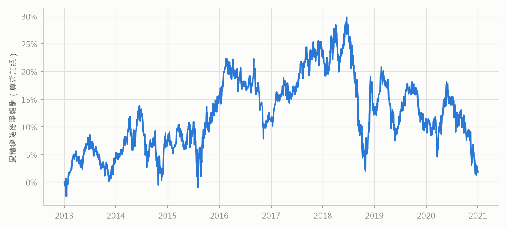

# 低換手 LightGBM＋台指期避險（walk-forward 2013–2020）

由 `qbot/tw_research/wf_lgb.py` 產生。

<b>預先承諾（原文，寫於任何 LightGBM 在 2013–2020 的預測或組合報酬計算之前）</b>

（原文複製自 claude-notes/journal/2026-10-04-Qbot低換手LightGBM台指期避險-walk-forward-預先承諾.md，寫定於任何 LightGBM 在 2013–2020 的預測或組合報酬計算之前；之後只能修程式錯誤，不得修改本段。）

## 本輪目的

第一輪 B2 的**事後探索**中，LightGBM＋Alpha158 在 TopkDropout n_drop=1（每天只換 1 檔）時，
2021–2026/09 的淨超額（對 top200 等權）為 +8.9%/年。那是看過測試期、16 個事後數字中最大的一個，不能當證據。
本輪只回答：**同一個模型、同一個低換手設定，在沒看過的 2013–2020，賣台指期避險、扣完成本後，相對大盤有沒有正報酬？**
並順帶回答使用者的問題「是否每年都能贏大盤」（描述，不參與判定）。

只檢驗一個主設定，不做參數或模型選擇。

## 我相信什麼

- 主判定為 **(?)**：避險後年化淨報酬 E 落在 −6% 到 +6% 之間；可偵測門檻太大，無法區分。
- 8 年中正報酬年數 3–6 年，**不會**每年都為正。
- 避險有效：避險後對台指期的實現 beta 在 ±0.2 以內。
- 個股期貨成本情境（每邊 0.05%）只比主設定好約 1–2%/年：n_drop=1 時年化交易成本只有約 2%，證交稅能省的不多。
- early stopping 的最佳樹數多數年份 < 20（第一輪測試期停在第 3 棵）。

## 為什麼相信

- **可偵測門檻（寫判準前先算，只用已看過的 2021–2026 資料）**：同一模型 n_drop=1 的組合對 0050 回歸後的殘差，
  追蹤誤差年化 23.9%（線性模型只有 11.8%，因為 LightGBM 挑的是高波動股）、NW 標準誤（5.75 年）9.6%，
  換算 8 年約 8.0%，**MDE 約 16%**。使用者知道這點後仍選擇照設計執行（2026-10-04）。
- 第一輪探索：LightGBM 的原始超額有一大部分來自 beta（對等權 1.16）與大多頭；扣掉 beta 的 alpha 約 +4.7%、t 1.4。
- 第三輪（線性模型、0050 避險）在 2013–2020 為 (?)，E +1.6%。
- **已看過的資料，在此揭露**：第三輪看過同一段期間（2013–2020）**線性模型**的逐年避險後報酬與 IC，
  知道 2020 年對 0050 避險的非台積電組合大幅落後。**本輪改用台指期避險，是看過那個結果之後、應使用者提問決定的**；
  為了可比較，0050 避險列為敏感度。台指期連續序列只檢查過與 0050 日報酬的相關係數（0.957）。
  B2 的 GBDT 用 2018–2020 做過 early stopping（不同模型、不同切分，本輪全部重訓）。
  **從未計算任何 LightGBM 在 2013–2020 的預測、IC 或組合報酬。**

## 資料（看結果前固定）

- 個股：前幾輪的 Yahoo 日線與 qlib 資料，股票池 top200（point-in-time）。不做跳動清理。
- 台指期：`python_台指最佳槓桿/data/fut_TX_YYYY.parquet`（FinMind TaiwanFuturesDaily），一般交易時段、月合約、收盤價。
  連續序列：計算 t 日報酬時持有「最後交易日在 t 之後」的最近月合約（到期日當天已換次月）。
  報酬是期貨價格變動，已內含正逆價差與預期股利。
- 0050（只用於敏感度）：證交所自建含息還原價。

## 定義（看結果前固定）

### 模型（walk-forward）

- 每個預測年 Y ∈ {2013, …, 2020}：LightGBM＋Alpha158，參數同 B2 的 M2（repo 台股 yaml：learning_rate 0.2、num_leaves 210、
  max_depth 8、lambda_l1 205.7、lambda_l2 581、colsample 0.8879、subsample 0.8789），固定 seed；Alpha158 預設前處理。
- 訓練 2008-01-01～**Y−2 年 12 月 20 日**；early stopping 用 **Y−1 年 1 月 1 日～12 月 20 日**；預測 Y 年全年。
  （2013 年的模型只用 2008–2011 訓練。）

### 組合

- qlib TopkDropout：topk 50、**n_drop 1**，收盤價成交，region tw（一張 1000 股），帳戶 10 億，
  手續費 0.1425%×0.28 每邊、最低 20 元、賣出證交稅 0.3%。分兩段回測（2015-06-01 切換漲跌停門檻 6.5% → 9.5%）。

### 避險

- 每月第一個交易日收盤，H = Σ w_i β_i；β_i 為過去 250 個交易日個股對**台指期連續報酬**的 OLS 斜率
  （觀測 < 120 記為 1，截斷 [0, 2]），從隔日起適用到下次更新日（含）；分段第一天 H = 0。
- 避險成本年化 0.3%（以 |H| 計）：每月轉倉兩邊 ×（期交稅 0.002% + 手續費 + 半個 tick）約 0.2%，取整加保守。
- h_t = 組合淨報酬_t − H_t × 台指期報酬_t − |H_t| × 0.3% / 252。

### 效果量與推論

- **E = h 的年化平均**，2013-01-02～2020-12-31；Newey-West t（lag 5），單尾 p。只有一項檢定。
- 年度、前後兩半（2013–2016／2017–2020）、剔除 h 最大 1% 交易日後的 E，定義同第三輪。

## 判準 —— 和假設同一個 commit

門檻與第三輪相同，材料性門檻 M = 年化 2%。

- **(+) 支持**：單尾 p < 0.05 ∧ E ≥ M ∧ 8 年中至少 5 年 h 平均 > 0 ∧ 前後兩半都 > 0 ∧ 剔除最好 1% 交易日後 E > 0。
- **(−) 無效果**：E + 1.645 × NW 標準誤 < M。
- **(?) 無法回答**：其他。報告寫「檢定力不足」並列出實際 MDE。

**附加標記（不改分類）**：避險後對台指期的實現 beta 絕對值 > 0.2 →「避險失效」；
(+) 但未避險組合對 top200 等權的 alpha ≤ 0 →「優勢可能來自大小型股的相對表現」。

**描述（不判定）**：「8 年是否全部為正」（使用者的問題）；2018–2020 子期；每年 rank IC 與 early stopping 樹數；
未避險組合相對台指期與 top200 等權的超額、beta、alpha。

**敏感度（只報告，不改判定）**：個股期貨成本情境（每邊 0.05%、0.15%，不付證交稅；未限制在有個股期貨的股票、
未計轉倉，所以是成本的**下限**）；n_drop 2、5；台指期避險成本 0%、1%；改用 0050 避險（第三輪的方法）；
完全不計成本。

**禁止事項**：

- 不得輸出「建議使用」，除非 (+)。
- 看到結果後不得更改模型、參數、切分、換手、避險方式、beta 視窗或任何門檻。
- 程式錯誤可以修，修正要寫進報告，並註明是否改變判定。
- 即使 (+)，也要先用 2026-09-30 之後的前瞻資料另立預先承諾，才能考慮實盤。

## 我可能錯在哪

- **檢定力**：MDE 約 16%，真實效果若在 2–16% 之間，結果是 (?)。這是設計上預期的，使用者已知情。
- **walk-forward 前段的訓練期很短**（2013 年的模型只有 4 年訓練、1 年 early stopping），樹模型可能更差。
- **高波動小型股的流動性**：LightGBM 挑的股票成交量較小，10 億帳戶、收盤價成交、沒有市場衝擊成本，對它特別樂觀。
- **存活者偏差**對高波動股的影響比較大（下市的多半是這類），會把 E 灌高。
- **台指期與股票收盤時間不同**（13:45 vs 13:30），日報酬有 15 分鐘的錯位，會增加 h 的雜訊、讓實現 beta 偏離 0。
- **個股期貨情境不是真的個股期貨回測**：沒有標的限制、價差資料與轉倉，只是把每邊成本換掉。

## 判定：(?)

附加標記：無

| 指標 | 全期 2013–2020 | 子期 2018–2020（描述） |
|---|---|---|
| E（避險後淨報酬，年化） | 0.23% | -7.27% |
| NW 標準誤 | 4.21% | 7.82% |
| t | 0.05 | -0.93 |
| 單尾 p | 0.478 | 0.824 |
| 95% 上界 | 7.16% | 5.59% |
| MDE（2×SE；事前估計 16.00%） | 8.42% | 15.63% |
| 正報酬年數 | 4 / 8 | 0 / 3 |
| 前半 2013–2016／後半 2017–2020 | 2.93%／-2.48% | — |
| 剔除最好 1% 交易日後的 E | -6.18% | -14.10% |
| 避險後對台指期的實現 beta | 0.011 | -0.034 |

| 年 | 避險後 h（年化） | rank IC | early stopping 最佳樹數 |
|---|---|---|---|
| 2013 | 4.47% | +0.0534 | 31 |
| 2014 | 3.39% | +0.0585 | 39 |
| 2015 | 8.06% | +0.0632 | 31 |
| 2016 | -4.28% | +0.0519 | 29 |
| 2017 | 11.94% | +0.0462 | 23 |
| 2018 | -11.01% | +0.0373 | 31 |
| 2019 | -0.97% | +0.0293 | 11 |
| 2020 | -9.73% | +0.0171 | 1 |

未避險組合（描述）：相對台指期超額 0.59%、beta 1.09、alpha -0.74%（t -0.17）；
相對 top200 等權超額 2.23%、beta 1.08、alpha 1.21%（t 0.55）。
平均避險比率 1.04。

| 敏感度（只報告） | E | t | 上界 | 正報酬年數 |
|---|---|---|---|---|
| 股票成本（主設定），n_drop 2 | 3.06% | 0.72 | 10.05% | 5/8 |
| 股票成本（主設定），n_drop 5 | 5.14% | 1.21 | 12.16% | 6/8 |
| 個股期貨每邊 0.05%，n_drop 1 | 1.64% | 0.39 | 8.60% | 5/8 |
| 個股期貨每邊 0.15%，n_drop 1 | 0.60% | 0.14 | 7.54% | 4/8 |
| 台指期避險成本 0% | 0.54% | 0.13 | 7.47% | 4/8 |
| 台指期避險成本 1% | -0.49% | -0.12 | 6.44% | 4/8 |
| 改用 0050 避險（C 的方法） | 1.17% | 0.23 | 9.71% | 4/8 |
| 完全不計成本（毛報酬、避險免費） | 2.43% | 0.58 | 9.36% | 5/8 |

| 情境 | 年化交易成本 | 每日換手（買賣合計） |
|---|---|---|
| 股票成本（主設定），n_drop 1 | 1.89% | 4.0% |
| 股票成本（主設定），n_drop 2 | 3.79% | 8.0% |
| 股票成本（主設定），n_drop 5 | 9.26% | 19.4% |
| 個股期貨每邊 0.05%，n_drop 1 | 0.51% | 4.0% |
| 個股期貨每邊 0.15%，n_drop 1 | 1.52% | 4.0% |
